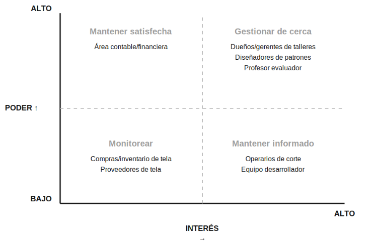

# Sistema Inteligente de Gestión de Mermas y Optimización de Corte Textil mediante IA

**Curso:** ISW-912 Administración de Proyectos Informáticos  
**Periodo:** III Cuatrimestre 2026  
**Proyecto:** Optimización del corte textil y reducción del desperdicio de tela

**Estudiantes:** María Jimena Jara Rojas y María Fernanda Sibaja Campos  
**Profesora:** Yesenia Calvo Araya  
**Sede:** Sede Regional de San Carlos

## Historial de versiones

| Versión | Semana | Fecha | Descripción |
|---|---|---|---|
| 1.0 | Clase 1 | 16/09/2026 | Presentación de la idea inicial, acta de constitución en borrador, Product Goal, definición del Scrum Team y preparación del repositorio. |
| 2.0 | Clase 2 | 23/09/2026 | Definición del proyecto, problema, solución propuesta y objetivos. Contexto organizacional, factores del entorno, restricciones, registro de interesados y mapa Poder-Interés. |
| 3.0 | Clase 3 | 30/09/2026 | Definición del ciclo de vida y planificación del primer Sprint, con su meta, historias seleccionadas e incremento previsto. |
| 4.0 | Clase 4 | 07/10/2026 | Elaboración del Product Backlog inicial, Sprint Backlog y mecanismo de seguimiento diario. |
| 5.0 | Clase 5 | 14/10/2026 | Definición del alcance y documentación de HU-01 y HU-02, con criterios de aceptación, estimaciones, prioridades, verificación INVEST y Definition of Done. |
| 6.0 | Clase 6 | 21/10/2026 | Estimación de subtareas del Sprint 1: HU-01 con 32 puntos y HU-02 con 11, para un total de 43 puntos de subtareas, con responsables. Matriz de estimación, Release Plan y presupuesto propuesto. |

## Contenido

- [Historial de versiones](#historial-de-versiones)
- [Definición del proyecto](#definición-del-proyecto)
- [Acta de constitución y Product Goal](#acta-de-constitución-y-product-goal)
- [Definición del Scrum Team](#definición-del-scrum-team)
- [Contexto organizacional y restricciones](#contexto-organizacional-y-restricciones)
- [Análisis de entorno](#análisis-de-entorno-eefs)
- [Taller de interesados del proyecto](#taller-de-interesados-del-proyecto)
- [Ciclo de vida y primer Sprint](#ciclo-de-vida-y-primer-sprint)
- [Alcance y Product Backlog priorizado](#alcance-y-product-backlog-priorizado)
- [Sprint Backlog y mecanismo de seguimiento](#sprint-backlog-y-mecanismo-de-seguimiento)
- [Historias de usuario](#historias-de-usuario)
- [Definition of Done v1.0](#definition-of-done-v10)
- [Estimación de subtareas del Sprint 1](#estimación-de-subtareas-del-sprint-1)
- [Matriz de estimación](#matriz-de-estimación)
- [Cronograma de entregas y costos](#cronograma-de-entregas-y-costos)

---

## Definición del proyecto

### Tema/Nombre

Sistema Inteligente de Gestión de Mermas y Optimización de Corte Textil mediante IA

### Estudiantes

María Jimena Jara Rojas y María Fernanda Sibaja Campos

### Problema

Las empresas y negocios dedicados a la confección de prendas necesitan utilizar grandes cantidades de tela para fabricar diferentes productos. Una distribución poco eficiente de los patrones durante el proceso de corte puede generar desperdicio de material, aumentar los costos de producción y dificultar el control sobre la cantidad de tela utilizada.

Actualmente, la planificación del corte puede realizarse de manera manual o mediante herramientas que no siempre consideran de forma integral las dimensiones de la tela, las cantidades requeridas, los diferentes tamaños de las prendas y las características de los patrones. Esto puede provocar un mayor porcentaje de material sobrante y dificultar la toma de decisiones antes de iniciar la producción.

El problema puede presentarse tanto en empresas de confección de gran volumen como en emprendimientos, marcas de ropa y negocios que producen cantidades menores de prendas.

### Proyecto propuesto

#### Descripción general

**Visión del producto:** esta descripción incluye capacidades de largo plazo. El compromiso propuesto para la entrega académica se delimita en [Alcance y Product Backlog priorizado](#alcance-y-product-backlog-priorizado); las funciones diferidas no forman parte del incremento de semana 11.

Desarrollar una plataforma web adaptable a dispositivos móviles que permita gestionar y optimizar el uso de tela durante la planificación de producción de prendas.

El sistema permitirá registrar los rollos de tela disponibles, sus dimensiones, características y cantidades requeridas para una producción. También permitirá cargar o registrar los patrones de las prendas y las cantidades necesarias de cada pieza.

Mediante algoritmos de optimización e Inteligencia Artificial (principalmente un algoritmo genético, apoyado en cálculos geométricos y en una heurística de colocación), el sistema analizará diferentes posibilidades de distribución de los patrones sobre la tela y propondrá una alternativa que busque maximizar el aprovechamiento del material y reducir el desperdicio.

#### Visualización de resultados

La plataforma mostrará visualmente la distribución propuesta y proporcionará información como:

- Cantidad de tela requerida.
- Porcentaje de aprovechamiento.
- Cantidad estimada de desperdicio.
- Cantidad de prendas que pueden producirse.
- Comparación entre diferentes alternativas de distribución.
- Estimación del costo asociado al material desperdiciado.
- Historial de producciones y desperdicios.

#### Usuarios de la plataforma

Además, contará con diferentes tipos de usuarios para permitir que pueda ser utilizada por emprendimientos, marcas de ropa, talleres y empresas de confección de mayor escala.

#### Registro de prendas y patrones

Cuando un cliente nuevo quiere agregar una prenda que el sistema aún no conoce, el sistema no depende de un catálogo cerrado. Cada pieza de la prenda se representa internamente como un contorno geométrico (un polígono con muchos puntos), lo que permite manejar desde un rectángulo hasta una forma curva, asimétrica o irregular. Para que cualquier cliente pueda cargar sus prendas, el sistema ofrece cuatro métodos:

#### Métodos de carga

- Plantillas con medidas. Para formas comunes (rectángulos, trapecios, círculos, mangas, cuellos, bolsillos), el usuario elige una plantilla e ingresa las medidas. Es el método más rápido para prendas sencillas.
- Importación de archivos de patrones. Si el cliente ya diseña sus patrones en programas de patronaje o diseño (como los que exportan archivos DXF o SVG), los sube directamente y el sistema extrae el contorno de cada pieza. Es el método más exacto para formas complejas.
- Fotografía o escaneo del patrón en papel. Para talleres y emprendimientos que usan moldes de papel, el usuario coloca el molde sobre un fondo que contraste, junto a una regla o marca de referencia, y lo fotografía con el celular. Un módulo de visión por computadora detecta el contorno, lo convierte a las medidas reales usando la referencia y lo muestra al usuario para que lo revise y ajuste.
- Editor de dibujo. El usuario dibuja la pieza con puntos y curvas, o corrige un contorno importado o detectado. Permite crear formas exóticas desde cero o ajustar detalles.

#### Proceso de registro

Sea cual sea el método, el proceso para agregar una prenda nueva sigue estos pasos:

1. El cliente crea la prenda (nombre, tipo y tallas) y agrega cada una de sus piezas por alguno de los cuatro métodos.
2. El sistema valida la geometría de cada pieza: que el contorno esté cerrado, que no se cruce consigo mismo, que la escala sea correcta y que la pieza quepa en el ancho de la tela disponible. Si hay un problema, muestra un mensaje claro para corregirlo.
3. El cliente indica las restricciones de cada pieza: dirección del hilo, rotaciones permitidas (ninguna, 180 grados o libre), margen de costura, si la pieza se corta en espejo (izquierda y derecha) y si la tela tiene sentido, pelo o estampado.
4. El cliente define las cantidades por pieza y por talla. Para otras tallas, puede cargar cada talla o aplicar una regla de escalado (gradación) sobre la talla base.
5. El sistema muestra una vista previa de las piezas y ejecuta una prueba de distribución sobre una tela de ejemplo para confirmar que la prenda funciona.
6. El cliente aprueba la prenda y esta se guarda en su biblioteca, con control de versiones, para reutilizarla en futuras órdenes de producción sin volver a cargarla.

#### Formas y características admitidas

El sistema debe soportar los siguientes tipos de formas y características:

- Formas rectas y geométricas: rectángulos, trapecios y triángulos.
- Formas curvas: cuellos, sisas, mangas, bajos redondeados y círculos completos o medios círculos.
- Formas cóncavas y asimétricas, con entradas y salidas en el contorno.
- Formas con huecos internos, por ejemplo una abertura dentro de la pieza.
- Piezas simétricas o en espejo, y piezas con dirección de hilo obligatoria.
- Piezas con estampado o cuadros que deben coincidir entre sí.
- Formas exóticas o de diseño (capas, volantes, cortes en espiral, drapeados), que se manejan como contornos irregulares.

El algoritmo de distribución trabaja con estos contornos reales, sin simplificarlos a cajas rectangulares, y considera las restricciones definidas para cada pieza. La Inteligencia Artificial (el algoritmo genético) interviene en la búsqueda y recomendación de las mejores alternativas de distribución; la detección del contorno a partir de fotografías se realiza con técnicas de visión por computadora.

#### Método de optimización: cómo se acomodan las piezas en la tela

Acomodar piezas irregulares sobre una tela sin desperdiciar es un problema conocido como nesting (empaquetado bidimensional de formas irregulares). No tiene una solución exacta que se calcule en un tiempo razonable, por lo que se resuelve con heurísticas y metaheurísticas, que son técnicas de Inteligencia Artificial clásica. El sistema propone una solución de buena calidad, no necesariamente la óptima, y la compara con otras alternativas. La solución se organiza en cuatro capas:

- Geometría de las piezas. Cada pieza es un polígono. Para saber si dos piezas pueden estar juntas sin traslaparse, se usa el No-Fit Polygon (NFP), que calcula todas las posiciones en las que una pieza toca a otra sin invadirla. Se puede implementar con librerías de geometría como Shapely y pyclipper.
- Colocación de las piezas. Dados un orden y una rotación para cada pieza, el sistema las coloca una por una con la heurística Bottom-Left: cada pieza se ubica lo más abajo y a la izquierda posible dentro del ancho del rollo. Esto genera una distribución completa, cuya calidad depende del orden y de las rotaciones elegidas.
- Búsqueda de la mejor distribución con un algoritmo genético. Este es el componente principal de Inteligencia Artificial. Funciona así:
  - Cromosoma: el orden de las piezas y la rotación de cada una (por ejemplo, 0 o 180 grados cuando la tela tiene dirección).
  - Aptitud (fitness): el porcentaje de aprovechamiento de la tela o, equivalentemente, el largo de tela consumido. Mientras menos tela se use, mejor es la solución.
  - Proceso: se genera una población de distribuciones al azar, se evalúa cada una con la colocación Bottom-Left, se combinan las mejores (cruce), se introducen cambios aleatorios (mutación) y se repite durante muchas generaciones hasta que la mejora se estabiliza.
  - Herramientas: la librería DEAP de Python para el algoritmo genético. Existen proyectos abiertos de nesting, como SVGnest y Deepnest, que usan un enfoque similar (NFP más algoritmo genético), lo que respalda la viabilidad de la técnica. Como alternativas de la misma familia se pueden evaluar el recocido simulado y la búsqueda tabú.

#### Tipo de Inteligencia Artificial utilizada

La Inteligencia Artificial de este proyecto es de tipo búsqueda y optimización (computación evolutiva), una rama reconocida de la IA. No se utilizan modelos de lenguaje ni redes neuronales, y el algoritmo genético no requiere datos de entrenamiento: optimiza cada orden de producción desde cero, lo que lo hace adecuado para un problema donde cada caso es distinto. El aprendizaje automático con datos históricos queda como una ampliación futura, una vez que el sistema haya acumulado información de producciones.

#### Visión por computadora y ampliaciones futuras

Para cargar patrones desde una fotografía se utiliza OpenCV (segmentación y detección de contornos), y como opción más avanzada un modelo de segmentación. En una etapa posterior, con el historial de producciones, un modelo de aprendizaje automático podría predecir el desperdicio esperado o sugerir un buen orden inicial para prendas similares.

#### Evaluación de resultados

Se comparará el porcentaje de aprovechamiento obtenido por el algoritmo genético contra una línea base simple (colocar las piezas de mayor a menor sin optimizar) y contra un acomodo manual, usando los mismos patrones y la misma tela. También se podrán utilizar conjuntos de datos públicos de referencia para este tipo de problema, como los del grupo ESICUP, para comparar con resultados conocidos.

### Valor esperado

Se espera proporcionar una herramienta que facilite la planificación del corte textil, permita tomar decisiones basadas en datos y contribuya a disminuir el desperdicio de tela.

El sistema también permitirá llevar un mejor control del consumo de materiales y generar información histórica que ayude a identificar patrones de desperdicio y oportunidades de mejora.

A largo plazo, la plataforma podría ampliarse con módulos de gestión de producción, control de inventario, control de calidad mediante visión artificial, cálculo de costos, proveedores y conexión entre empresas que requieren producción y empresas que ofrecen capacidad de confección.

### Objetivos

#### Objetivo general

Desarrollar una plataforma web para la planificación y optimización del corte de patrones textiles, utilizando un algoritmo genético como técnica de Inteligencia Artificial, con el propósito de mejorar el aprovechamiento de la tela y reducir el desperdicio durante la producción de prendas.

#### Objetivos específicos

- Diseñar e implementar una plataforma web adaptable a dispositivos móviles que permita registrar y gestionar rollos de tela, prendas, patrones y órdenes de producción, considerando las dimensiones y restricciones necesarias para el proceso de corte.
- Desarrollar un módulo de optimización basado en un algoritmo genético, apoyado en cálculos geométricos y una heurística de colocación, que genere y visualice diferentes distribuciones de patrones sobre la tela y permita calcular el porcentaje de aprovechamiento, el desperdicio y el consumo estimado de material.
- Evaluar el funcionamiento del sistema mediante casos de prueba con diferentes patrones, cantidades y dimensiones de tela, comparando los resultados obtenidos mediante el algoritmo de optimización con una línea base de distribución y, cuando sea posible, con un acomodo manual.

---

## Acta de constitución y Product Goal

El acta define el propósito, los entregables y las condiciones iniciales del proyecto. Su aprobación está pendiente.

| Elemento | Definición propuesta |
|---|---|
| Nombre | Sistema Inteligente de Gestión de Mermas y Optimización de Corte Textil mediante IA |
| Justificación | La distribución ineficiente de patrones puede desperdiciar tela y aumentar el costo de producción. Se propone apoyar la decisión antes del corte mediante una distribución válida e indicadores comparables. |
| Propósito | Construir y evaluar un prototipo académico que conecte la colocación geométrica de piezas, su optimización y la visualización de resultados. |
| Equipo responsable | María Jimena Jara Rojas y María Fernanda Sibaja Campos; distribución de responsabilidades en la definición del Scrum Team. |
| Cliente y patrocinio | No hay empresa cliente ni patrocinador externo confirmado. La profesora evalúa el proyecto académico; esto no implica patrocinio financiero ni validación comercial. |
| Entregables | Expediente actualizado, repositorio con código y evidencias, prototipo ejecutable, informe final y demostración del incremento. |
| Inicio y cierre | Inicio documental: 16/09/2026. Entrega oficial en semana 11; fecha proyectada: 25/11/2026, sujeta al calendario docente. El desarrollo y la preparación de la entrega se completan durante las semanas 1 a 10. |
| Recursos | Dos estudiantes, equipos existentes y herramientas de software disponibles; capacidad e importes propuestos en el plan temporal y de costos. |
| Riesgos iniciales | Complejidad geométrica, sobreestimación de capacidad, falta de patrones reales e integración tardía. Se mitigan con un alcance acotado, datos sintéticos y entregas por Sprint. El registro detallado se desarrollará en la semana correspondiente. |
| Autoridad y cambios | La Product Owner propone el orden y el alcance; las Developers estiman y organizan la implementación. Los cambios que afecten la evaluación se consultan a la profesora. Toda variación se documenta con su impacto en alcance, fecha y costo. |
| Estado de aprobación | Borrador pendiente de revisión por el equipo y la profesora. |

### Product Goal

Permitir que una persona encargada del corte textil configure un caso sencillo, obtenga una distribución de piezas sin traslapes y compare el aprovechamiento de una colocación base con una alternativa optimizada, mediante un prototipo web demostrable en la semana 11.

### Criterios de éxito del proyecto

1. Ejecutar de principio a fin tres casos sintéticos identificados y reproducibles, incluyendo rectángulos, trapecios y una pieza cóncava.
2. Mantener todas las piezas dentro del rollo y sin intersecciones de área; ante entradas inválidas, informar el problema sin presentar una solución como válida.
3. Mostrar el largo consumido, el aprovechamiento y el desperdicio usando las mismas unidades y fórmulas para ambas alternativas.
4. Comparar la línea base con el algoritmo genético bajo las mismas condiciones, registrando semilla, parámetros y resultados. No se promete un porcentaje de ahorro ni una solución óptima.
5. Entregar las historias del MVP que cumplan sus criterios y la DoD, junto con instrucciones de ejecución, evidencias e informe. Las funciones incompletas se declaran pendientes.

## Definición del Scrum Team

| Rol | Integrante asignada (propuesta) | Responsabilidades hasta la entrega en semana 11 |
|---|---|---|
| Product Owner | María Jimena Jara Rojas | Definir y comunicar la meta del producto, ordenar el Product Backlog y priorizar las funciones según las necesidades de los usuarios y el tiempo disponible |
| Scrum Master | María Fernanda Sibaja Campos | Promover la aplicación de Scrum, facilitar los eventos cuando sea necesario, ayudar a resolver impedimentos y apoyar la mejora de la efectividad del equipo |
| Developers | María Jimena Jara Rojas y María Fernanda Sibaja Campos | Analizar, diseñar, programar, integrar, probar y documentar la solución; organizar el trabajo técnico para alcanzar la meta de cada Sprint y asegurar la calidad del incremento |

## Contexto organizacional y restricciones

**Secciones 02–03 · Semana 2.** El escenario de referencia es un taller pequeño de confección que planifica sus cortes con patrones y rollos de tela. El prototipo se validará inicialmente con casos sintéticos; la validación con un taller real queda pendiente.

### Organización y flujo de trabajo

En el escenario propuesto, la persona dueña o encargada decide qué producir y valida el uso de material; la patronista prepara las piezas y restricciones; los operarios ejecutan el corte. El prototipo apoya la planificación y no controla maquinaria. El flujo previsto es: definir tela y piezas → validar entradas → generar línea base → optimizar → comparar → revisar la propuesta antes del corte.

El equipo académico se organiza alrededor del proyecto, con dos integrantes que comparten desarrollo. La autoridad comercial del taller y la evaluación docente son externas al equipo. Las necesidades atribuidas a los interesados son hipótesis hasta obtener retroalimentación real.

| Restricción | Aplicación al proyecto |
|---|---|
| Fecha académica | Entrega oficial en semana 11; planificación de alcance, tiempo y costos hasta la semana 6. |
| Personal y capacidad | Solo dos Developers; se propone reservar 10 horas por integrante por semana durante los Sprints. Disponibilidad por confirmar. |
| Infraestructura | Demostración local en un equipo existente. No depender de un alojamiento de pago o de conexión durante la demo. |
| Datos | Emplear casos sintéticos mientras no existan patrones reales autorizados; no afirmar validación industrial. |
| Geometría del MVP | Polígonos simples en centímetros, sin huecos ni escalado de tallas; piezas completas, cantidades enteras positivas y ancho positivo. |
| Producto | Un único escenario de taller y una sesión local; sin gestión de múltiples empresas, cuentas o permisos en el MVP. |
| Presupuesto | No hay financiamiento confirmado. Los costos documentados son una simulación académica, sin autorización de compra. |

### Activos disponibles y decisiones

Se reutilizan la plantilla de historias de usuario de Materia, las presentaciones del curso, el MD existente, el mapa de interesados y los trabajos previos. El repositorio y el historial de versiones permiten mantener trazabilidad. No se asume que exista una política o un procedimiento propio de un taller cliente.

La Product Owner registra propuestas de cambio con fecha, motivo, ítems afectados, efecto temporal y económico y decisión. Las Developers evalúan viabilidad; la Scrum Master facilita la discusión de impedimentos. Si el cambio modifica compromisos académicos, se solicita criterio docente antes de presentarlo como aceptado. Este mecanismo inicial se ampliará con las responsabilidades y comunicación de las semanas posteriores.

## Análisis de entorno (EEFs)

### Factores ambientales que impactan el proyecto

| Factor ambiental | Condición conocida o por verificar | Impacto en la solución | Respuesta prevista |
|---|---|---|---|
| Calendario y requisitos académicos | El proyecto se construye durante las semanas 1 a 10 y se entrega en la semana 11 | Limitan el tiempo y condicionan los entregables | Priorizar las funciones y ajustar la planificación al calendario oficial |
| Infraestructura tecnológica disponible | Verificar capacidad de las computadoras, conexión y alojamiento disponible | Puede limitar la ejecución del algoritmo genético y las demostraciones | Realizar pruebas de rendimiento en los equipos disponibles y evaluar ejecución local |
| Acceso a usuarios del sector textil | Confirmar disponibilidad de dueños, patronistas y operarios para entrevistas y pruebas | Condiciona la validación de necesidades y resultados | Coordinar su participación y documentar las limitaciones si no se consigue acceso |
| Disponibilidad y uso de patrones | Confirmar formatos, medidas y permisos para utilizar patrones reales | Determina los casos de prueba y las posibilidades de publicar ejemplos | Utilizar material autorizado o casos sintéticos identificados como tales |
| Cultura y procesos del taller | Investigar cómo se planifican los cortes y la disposición a incorporar herramientas digitales | Influye en la facilidad de uso y aceptación del sistema | Validar el flujo de trabajo con usuarios antes de asumir necesidades específicas |
| Distribución geográfica y conectividad | Modalidad de trabajo del equipo y ubicación de los usuarios por confirmar | Puede dificultar coordinación, entrevistas y demostraciones | Acordar canales de comunicación y alternativas de reunión |
| Privacidad y confidencialidad | Verificar las condiciones aplicables a datos personales y patrones comerciales que se compartan | Puede restringir acceso, almacenamiento y publicación de información | Minimizar datos y acordar permisos antes de incorporar información del taller |
| Recursos económicos y licencias disponibles | Presupuesto y acceso a servicios por confirmar | Condicionan herramientas, alojamiento y despliegue | Priorizar recursos disponibles y evaluar costos antes de contratar servicios |
---

## Taller de interesados del proyecto

### Identificación y registro de interesados

Para el registro utilizamos una escala de **1 a 5** para poder e interés. Consideramos **1 a 3 como bajo** y **4 a 5 como alto**.

| Interesado | Rol / relación | Necesidad | Poder | Interés | Actitud | Estrategia |
|---|---|---|---:|---:|---|---|
| Dueños/gerentes de talleres y empresas de confección | Clientes y posibles usuarios decisores | Reducir el desperdicio de tela y bajar costos de producción | 5 | 5 | Favorable | Gestionar de cerca |
| Diseñadores de patrones / patronistas | Usuarios especializados del sistema | Que el sistema interprete correctamente sus patrones, incluidas las formas irregulares | 4 | 5 | Favorable | Gestionar de cerca |
| Profesora evaluadora | Evaluador del proyecto | Que el proyecto cumpla los objetivos y la metodología del curso | 5 | 4 | Neutral | Gestionar de cerca |
| Operarios de corte | Usuarios del resultado del sistema | Recibir instrucciones de distribución claras y aplicables en planta | 2 | 4 | Mixta | Mantener informado |
| Equipo desarrollador (nosotras) | Responsables del desarrollo | Mantener un alcance manejable durante el tiempo disponible del curso | 3 | 5 | Favorable | Mantener informado |
| Área contable/financiera del cliente | Área que revisa el impacto económico | Ver el ahorro real en material y valorar la inversión | 4 | 2 | Neutral | Mantener satisfecha |
| Encargados de compras/inventario de tela | Responsables de controlar materiales | Registrar correctamente los rollos de tela disponibles | 2 | 3 | Neutral | Monitorear |
| Proveedores de tela | Proveedores externos relacionados con el material | Mantener su volumen de venta | 1 | 2 | Neutral | Monitorear |

### Justificación de los casos discutibles

No todos los valores fueron evidentes desde el inicio. Estos fueron los casos que más tuvimos que analizar:

- **Diseñadores de patrones (poder 4):** al inicio pensamos asignarles menos poder porque no son quienes pagan por el sistema. Sin embargo, su participación es importante porque un patrón mal cargado o que el sistema no interprete correctamente puede afectar el resultado de la optimización. Por eso consideramos que tienen un poder alto dentro de la operación del sistema.
- **Equipo desarrollador (poder 3, interés 5):** el interés es alto porque somos responsables directamente del desarrollo. El poder se mantiene en un nivel medio porque las decisiones importantes de alcance también dependen de los requisitos del curso y de las condiciones del proyecto.
- **Área contable/financiera (interés 2):** aunque el proyecto busca reducir costos, esta área no participa constantemente en el desarrollo. Su participación sería más importante al analizar presupuesto, ahorro o resultados económicos.
- **Proveedores de tela (poder 1):** podrían verse afectados si disminuye el desperdicio y, por lo tanto, cambia el consumo de tela. Sin embargo, no tienen capacidad directa para aprobar, modificar o bloquear las decisiones del proyecto.

### Mapa Poder-Interés

El mapa utiliza la misma escala de 1 a 5. Para definir los cuadrantes consideramos de **1 a 3 como bajo** y de **4 a 5 como alto**.

	

Distribución por cuadrante:

| Cuadrante | Estrategia | Interesados |
|---|---|---|
| Poder alto, interés alto | Gestionar de cerca | Dueños/gerentes de talleres, diseñadores de patrones, profesor evaluador |
| Poder alto, interés bajo | Mantener satisfecha | Área contable/financiera |
| Poder bajo, interés alto | Mantener informado | Operarios de corte, equipo desarrollador |
| Poder bajo, interés bajo | Monitorear | Compras/inventario de tela, proveedores de tela |

### Preguntas de análisis del grupo

#### ¿A quién debemos involucrar primero?

Debemos involucrar primero a los **dueños o gerentes de talleres y empresas de confección**, porque pueden validar si el sistema realmente responde al problema que se quiere resolver. También es importante involucrar desde el inicio a los **diseñadores de patrones**, ya que conocen directamente los tipos de patrones y las dificultades que el sistema debe manejar.

#### ¿Quién puede bloquear una decisión?

Los **dueños o gerentes** y el **profesor evaluador** tienen capacidad para condicionar decisiones importantes. Los primeros pueden decidir si el sistema resulta útil para su operación, mientras que el profesor establece los criterios que debe cumplir el proyecto dentro del curso.

#### ¿Quién necesita información frecuente?

Los **dueños o gerentes**, los **diseñadores de patrones**, el **profesor evaluador** y el **equipo desarrollador** necesitan información frecuente sobre avances, pruebas y cambios. Los operarios también deben recibir información cuando existan cambios que afecten las instrucciones de corte.

#### ¿Qué interesado estamos subestimando?

Consideramos que los **operarios de corte** podrían ser el interesado que más fácilmente se subestima. Aunque tienen un poder menor, son quienes podrían utilizar directamente las instrucciones generadas por el sistema. Si estas no son claras o prácticas, el resultado puede ser difícil de aplicar en la operación real.

#### ¿Qué conflicto de expectativas puede aparecer?

Puede aparecer un conflicto entre la necesidad de los **dueños o gerentes de obtener ahorro y resultados** y las limitaciones del **equipo desarrollador**, especialmente por el tiempo disponible para desarrollar y probar la inteligencia artificial. También puede existir una diferencia entre lo que los **patronistas** esperan que el sistema interprete y lo que técnicamente sea posible implementar dentro del alcance del curso.

### Los tres interesados críticos

#### 1. Dueños/gerentes de talleres y empresas de confección

Son quienes pueden validar el valor práctico del sistema y decidir si resulta útil para su operación. Planeamos involucrarlos mediante demostraciones periódicas del prototipo, recopilando retroalimentación sobre las funciones y verificando que el sistema responda al problema del desperdicio de tela.

#### 2. Diseñadores de patrones / patronistas

Participan directamente en una de las partes más importantes del sistema. Realizaremos pruebas con patrones reales, incluyendo formas irregulares, y solicitaremos retroalimentación sobre las diferentes formas de cargar o representar los patrones, como archivos DXF/SVG, fotografías o dibujo.

#### 3. Profesora evaluadora

Sus criterios son importantes porque el proyecto debe cumplir con los objetivos y metodología establecidos para el curso. Planeamos mostrar avances en las entregas correspondientes y consultar oportunamente cuando existan dudas sobre el alcance o la metodología.

### ¿Predictivo, adaptativo o híbrido?

El proyecto se gestionará con un enfoque **híbrido**.   

El alcance general fue definido desde el Trabajo #1 y el curso tiene una fecha de entrega establecida. Por esta razón, algunas partes pueden planificarse anticipadamente, como los módulos relacionados con tela, patrones y órdenes de producción.

Sin embargo, el módulo de optimización presenta mayor incertidumbre. El algoritmo genético, la heurística de colocación y la visión por computadora para interpretar patrones a partir de una fotografía requieren pruebas, ajustes y retroalimentación. Es posible que debamos modificar algunos aspectos conforme obtengamos resultados de las pruebas con distintos tipos de piezas.

Por estas características, el enfoque híbrido se adapta al contexto del proyecto: permite mantener una planificación estable para los elementos definidos y, al mismo tiempo, utilizar ciclos de prueba y adaptación en las partes que presentan mayor incertidumbre.

---

## Ciclo de vida y primer Sprint

**Sección 04 · Semana 3.** Se mantiene el enfoque híbrido justificado en el análisis de interesados: hitos académicos fijos y construcción iterativa del producto.

| Fase | Periodo de referencia | Resultado o condición de salida |
|---|---|---|
| Inicio | Semanas 1–2, 16/09–30/09 | Problema, equipo, meta, contexto e interesados documentados; supuestos identificados. |
| Preparación | Semanas 3–4, 30/09–14/10 | Ciclo de vida, backlog inicial y plan del primer Sprint. |
| Construcción incremental | Sprints 1–3, 14/10–25/11 | Motor base, optimización y prototipo web; inspección y adaptación en cada Sprint. |
| Verificación y consolidación | Continua; énfasis en semana 10, 18/11–25/11 | Casos reproducibles, integración, expediente, evidencias y preparación de demo. |
| Cierre | Semana 11, 25/11 proyectado | Demo, informe final, alcance logrado y pendiente, lecciones aprendidas y entrega del repositorio. |

Las fechas límite de periodos consecutivos representan el cambio de fase; no agregan días de trabajo. La verificación acompaña al desarrollo y no se aplaza íntegramente al cierre.

### Plan del primer Sprint

- **Periodo:** 14/10/2026 al 28/10/2026; duración de dos semanas.
- **Sprint Goal:** obtener un trazo geométricamente válido y reproducible de piezas sintéticas sobre un rollo de ancho definido, acompañado de sus indicadores de aprovechamiento y desperdicio.
- **Selección:** PB-01/HU-01 y PB-02/HU-02, 11 puntos propuestos. Se eligen porque sin colocación válida e indicadores no se puede verificar la mejora del optimizador.
- **Incremento previsto:** motor ejecutable localmente con imagen del trazo y tabla o salida de consola; todavía sin interfaz web.
- **Entrada al Sprint:** disponer de ejemplos de polígonos, unidades comunes, ancho de rollo y criterios de aceptación. Revisar el plan si falta alguno.
- **Situación al corte documental:** las historias y tareas están descritas; no se aportan código ni resultados que acrediten su terminación.

Cada Sprint comienza con Planning para revisar meta y capacidad. Durante su ejecución se inspecciona el tablero mediante Daily Scrum. La Review examina el incremento contra criterios y DoD; la Retrospective define una mejora para el siguiente Sprint. En el cierre de un Sprint y apertura del siguiente se registra la transición sin duplicar capacidad.

## Alcance y Product Backlog priorizado

**Secciones 05–06 · Semanas 4–5.** Esta declaración delimita la visión extensa descrita al inicio. Los elementos diferidos conservan su identificador, pero no son compromisos de entrega en semana 11.

### Alcance del producto para la entrega académica

El MVP incluye PB-01, PB-02, PB-03, PB-04, PB-05, PB-06 y PB-11: colocación base de polígonos simples, métricas, rotaciones restringidas, búsqueda genética, captura básica de tela y piezas y una interfaz web adaptable con comparación de alternativas. El uso será local, para un taller de referencia, sin cuentas ni almacenamiento histórico.

Se admitirán coordenadas o plantillas sencillas y cantidades de piezas, sin archivos de patronaje. En Sprint 1 se trabajará con ejemplos preparados; la captura desde la web se incorporará al final. Las restricciones de rotación de PB-03 serán ninguna o 180 grados. Las curvas deberán representarse como polígonos suministrados en los casos; no se promete su digitalización automática.

Quedan fuera del MVP: importación DXF/SVG, fotografía y visión por computadora, editor avanzado, gradación, piezas con huecos, coincidencia de estampados, márgenes automáticos, inventario persistente, biblioteca versionada, cuentas, multiempresa, órdenes persistentes, exportación industrial, cálculo económico del desperdicio e historial. Tampoco se incluye operación en planta ni garantía de ahorro real.

### Alcance del proyecto y aceptación

El trabajo comprende análisis, refinamiento, diseño de entradas y resultados, implementación, pruebas, integración, documentación, preparación de casos y demo, informe final y cierre. La estimación de cada historia debe incluir su diseño, pruebas y documentación, sin contarlas de nuevo como funcionalidades adicionales.

Cada historia se acepta contra sus criterios y la DoD. El equipo registra el resultado y la evidencia; las observaciones dla profesora e interesados se incorporan como cambios. La aceptación académica final corresponde a la profesora. Si no participa un taller real, se declara esa limitación en el informe.

### Product Backlog inicial ordenado

El orden de las filas expresa prioridad de trabajo; los ID no indican orden de ejecución. **MVP** significa incluido en el release académico propuesto. **Diferido** significa fuera de ese release, pendiente de refinamiento y capacidad futura. Todas las historias están pendientes de verificar su implementación.

| Orden | ID / historia | Necesidad expresada como historia | Prioridad | Destino |
|---:|---|---|---|---|
| 1 | PB-01 / HU-01 | Como patronista, quiero colocar piezas sin traslapes para obtener un trazo válido. | Alta | MVP, Sprint 1 |
| 2 | PB-02 / HU-02 | Como encargado, quiero ver consumo y desperdicio para evaluar el trazo. | Alta | MVP, Sprint 1 |
| 3 | PB-03 / HU-03 | Como patronista, quiero limitar las rotaciones para respetar la dirección de las piezas. | Alta | MVP, Sprint 2 |
| 4 | PB-04 / HU-04 | Como encargado, quiero comparar una búsqueda genética con la base para elegir una distribución eficiente. | Alta | MVP, Sprint 2 |
| 5 | PB-05 / HU-05 | Como patronista, quiero definir el ancho del rollo para planificar sobre la tela disponible. | Alta | MVP, Sprint 3 |
| 6 | PB-06 / HU-06 | Como patronista, quiero ingresar polígonos o plantillas sencillas y cantidades para configurar un corte. | Alta | MVP, Sprint 3 |
| 7 | PB-11 / HU-11 | Como encargado, quiero ejecutar y comparar trazos en una pantalla adaptable para revisar el resultado. | Alta | MVP, Sprint 3 |
| 8 | PB-07 / HU-07 | Como patronista, quiero importar SVG para reutilizar patrones digitales. | Media | Diferido |
| 9 | PB-08 / HU-08 | Como patronista, quiero importar DXF para reutilizar archivos de patronaje. | Media | Diferido |
| 10 | PB-09 / HU-09 | Como patronista, quiero detectar contornos en fotografías para digitalizar moldes. | Baja | Diferido |
| 11 | PB-10 / HU-10 | Como patronista, quiero editar contornos visualmente para corregir las piezas. | Media | Diferido |
| 12 | PB-12 / HU-12 | Como encargado, quiero una biblioteca persistente de prendas para reutilizarlas. | Media | Diferido |
| 13 | PB-13 / HU-13 | Como patronista, quiero escalar tallas para preparar variantes de una prenda. | Baja | Diferido |
| 14 | PB-14 / HU-14 | Como patronista, quiero distribuir piezas con huecos para trabajar diseños complejos. | Baja | Diferido |
| 15 | PB-15 / HU-15 | Como patronista, quiero respetar márgenes y coincidencias de estampados para preparar cortes especiales. | Baja | Diferido |
| 16 | PB-16 / HU-16 | Como encargado, quiero gestionar cuentas y talleres para separar accesos. | Baja | Diferido |
| 17 | PB-17 / HU-17 | Como encargado, quiero mantener inventario de rollos para conocer existencias. | Media | Diferido |
| 18 | PB-18 / HU-18 | Como encargado, quiero calcular el costo del desperdicio para valorar su impacto económico. | Media | Diferido |
| 19 | PB-19 / HU-19 | Como encargado, quiero guardar órdenes de producción para dar seguimiento a los cortes. | Media | Diferido |
| 20 | PB-20 / HU-20 | Como encargado, quiero consultar el historial para comparar producciones anteriores. | Media | Diferido |

### Criterios de aceptación de las historias adicionales del MVP

Los criterios de HU-01 y HU-02 se mantienen en la sección de historias. Los siguientes son criterios propuestos para refinamiento antes de incorporar cada historia a su Sprint.

| Historia | Criterios verificables |
|---|---|
| HU-03 | Dada una pieza con rotación prohibida, al colocarla conserva su orientación; dada una pieza que admite 180°, solo se evalúan 0° y 180°; una alternativa que viole la restricción se rechaza. La imagen y los datos reflejan la orientación elegida. |
| HU-04 | Dadas las mismas piezas y restricciones, al optimizar se genera una alternativa válida y se comparan largo y aprovechamiento con la base. Se registra semilla, tamaño de población, generaciones y condición de parada. Repetir con los mismos parámetros y entorno reproduce el resultado. Se conserva la línea base si la búsqueda no la mejora; un empate se muestra como tal. Se ejecutan tres casos sintéticos sin prometer un ahorro mínimo. |
| HU-05 | Dado un ancho positivo en centímetros, al confirmar se utiliza ese ancho en el cálculo; ante cero, valor negativo, vacío o no numérico, se impide ejecutar y se explica el error. El formulario identifica unidad y ancho vigente. |
| HU-06 | Dado un polígono simple o una plantilla de rectángulo/trapecio con medidas válidas, al registrar una cantidad entera positiva se genera esa cantidad de piezas. Se rechazan contornos autointersectados, área nula, cantidades inválidas y piezas que no caben en las orientaciones permitidas. Se muestra una vista previa; no se admiten huecos. |
| HU-11 | Dado un caso válido capturado, al ejecutar se muestran base y alternativa optimizada, largo, aprovechamiento y desperdicio con unidades comunes. Ante entrada inválida se identifica el campo y no se muestra un resultado inválido como exitoso. En anchos de vista de 360 y 1280 píxeles los controles son utilizables; la visualización admite ajuste o desplazamiento interno sin ocultar acciones. Se puede ejecutar localmente con las instrucciones del repositorio. |

### Requisitos no funcionales y trazabilidad

| Requisito / origen | Entregable y verificación |
|---|---|
| R-01: validez geométrica / problema y patronista | PB-01, PB-03, PB-06 y PB-04; pruebas de límites, traslapes y orientación. |
| R-02: medición comparable / objetivo de reducir merma | PB-02 y PB-11; casos de área conocida, suma de porcentajes de 100 % con tolerancia de 0,01 puntos porcentuales por redondeo. |
| R-03: evaluación de IA / objetivos del proyecto | PB-04; comparación base/genético en tres casos con parámetros registrados, sin declarar mejoras no medidas. |
| RNF-01: reproducibilidad / evaluación académica | PB-01 y PB-04; versiones del entorno, datos, semilla y procedimiento documentados. |
| RNF-02: uso en distintos tamaños / visión web adaptable | PB-11; revisión de controles y visualización en 360 y 1280 píxeles. |
| RNF-03: ejecución acotada / capacidad del equipo | PB-04 y PB-11; límite configurable de generaciones y tiempo, inicialmente 30 segundos por caso de hasta 20 piezas. Registrar equipo y tiempos; si el equipo no logra ese objetivo, reducir tamaño del caso o ajustar el objetivo con evidencia antes de aceptarlo. |
| RNF-04: datos y recuperación / escenario académico | Todo el MVP; casos sintéticos identificados, sin datos personales necesarios; errores de entrada no deben cerrar la aplicación ni presentarse como soluciones válidas. |

## Sprint Backlog y mecanismo de seguimiento

El Sprint Backlog desglosa HU-01 y HU-02 en diez tareas, con responsables, dependencias y evidencia esperada. Los puntos de cada tarea se presentan en la sección de estimación de subtareas.

| Tarea | Historia | Responsable | Dependencia de trabajo | Estado verificable al 22/10 | Evidencia esperada |
|---|---|---|---|---|---|
| T-01 | HU-01 | Jimena | Ninguna | Por hacer | Datos de piezas y rollo con unidades |
| T-02 | HU-01 | Fernanda | T-01 | Por hacer | Código de colocación |
| T-03 | HU-01 | Jimena | T-02 | Por hacer | Pruebas de traslapes y límites |
| T-04 | HU-01 | Fernanda | T-01; integración con T-02 | Por hacer | Caso de pieza demasiado ancha |
| T-05 | HU-01 | Jimena | T-02 | Por hacer | Comparación de dos ejecuciones |
| T-06 | HU-01 | Fernanda | T-02 | Por hacer | Imagen del trazo |
| T-07 | HU-01 | Jimena | T-03, T-04, T-05 y T-06 | Por hacer | Resultados de casos geométricos |
| T-08 | HU-02 | Fernanda | Distribución de ejemplo; luego T-02 | Por hacer | Cálculo del largo |
| T-09 | HU-02 | Jimena | T-08 y áreas de piezas | Por hacer | Cálculos de porcentajes |
| T-10 | HU-02 | Fernanda | T-08 y T-09 | Por hacer | Salida de indicadores y pruebas |

### Tablero y eventos propuestos

La tabla del Sprint Backlog funciona como tablero versionado en el repositorio. La columna Estado utiliza **Por hacer, En curso, En revisión y Terminado**. En cada Daily Scrum se actualizan el estado, las dependencias y la evidencia; los impedimentos y sus acciones se anotan en el registro de seguimiento. Al iniciar el control documental, las tareas figuran como Por hacer hasta verificar su implementación. Una tarea pasa a Terminado únicamente con su evidencia y revisión.

Cada integrante actualizará sus tarjetas al trabajar. El Daily Scrum durará como máximo 15 minutos en los días de trabajo: inspeccionar avance hacia la meta, identificar impedimentos y ajustar el siguiente paso. Si no coinciden, dejarán una actualización escrita para coordinarse. Se propone limitar a una tarea en curso por integrante y revisar primero las que bloquean a la otra.

La revisión de código corresponde a la otra integrante. En la Review se demuestra cada historia, se comprueban criterios y DoD y se registran observaciones; en la Retrospective se elige una mejora concreta. Las tareas no terminadas se reevalúan para el siguiente Sprint sin prolongar el actual y sin sumar puntos a la velocidad.

### Registro de seguimiento

| Fecha | Historia/tarea | Estado | Impedimento | Acción y responsable | Evidencia |
|---|---|---|---|---|---|
| 22/10/2026 | HU-01 y HU-02 / T-01 a T-10 | Planificado; implementación pendiente de verificar | Implementación no registrada en el repositorio | Ambas: actualizar estados con el código y los resultados reales antes de la Review | Sprint Backlog; resultados pendientes |

## Historias de usuario

### Historia de Usuario HU-01

#### Título

Colocación automática de piezas sobre el rollo de tela sin traslapes

#### Estructura o plantilla clásica (Card)

- **Como:** Patronista (persona encargada del trazo y el corte en un taller de confección).
- **Quiero:** Que el sistema acomode automáticamente las piezas de una prenda sobre un rollo de tela de ancho definido, respetando el contorno real de cada pieza.
- **Para:** Obtener un trazo de corte válido, sin piezas encimadas ni fuera de la tela, sin tener que acomodarlas a mano.

**Historia completa:** Como patronista, quiero que el sistema acomode automáticamente las piezas de una prenda sobre un rollo de tela de ancho definido, respetando el contorno real de cada pieza, para obtener un trazo de corte válido, sin piezas encimadas ni fuera de la tela, sin tener que acomodarlas a mano.

#### Criterios de aceptación (Confirmation)

1. Dado que existe un conjunto de piezas válidas de una prenda y un rollo con un ancho definido, cuando la patronista ejecuta la colocación, entonces todas las piezas quedan dentro del ancho del rollo.
2. Dado que se generó una distribución, cuando el sistema verifica la geometría de las piezas, entonces ningún par de piezas se traslapa (pueden tocarse por el borde).
3. Dado que se usan las mismas piezas y los mismos parámetros, cuando se ejecuta la colocación dos veces, entonces se obtiene exactamente la misma distribución.
4. Dado que una pieza es más ancha que el rollo, cuando se ejecuta la colocación, entonces el sistema informa qué pieza no cabe y no entrega una distribución inválida.
5. Dado que se generó una distribución, cuando la patronista solicita verla, entonces el sistema genera una imagen con cada pieza en su posición sobre el rollo.

#### Estimación y prioridad

- **Prioridad:** Alta.
- **Estimación:** 8 puntos de historia (secuencia Fibonacci). Estimación inicial del equipo, por confirmar con Planning Poker.
- **Ítem del Product Backlog:** PB-01, Sprint 1 (14/10/2026 al 28/10/2026).

#### Notas adicionales o anexos

- **Diseños/Wireframes:** No aplica en este Sprint. El resultado se entrega como una imagen generada por el motor (tarea T-06 del Sprint Backlog 1); la pantalla web se diseñará en un Sprint posterior.
- **Notas técnicas:** La colocación usa la heurística Bottom-Left con geometría real de polígonos (Shapely). Se prueba con casos sintéticos: rectángulos, trapecios y una pieza cóncava.
- **Dependencias:** Ninguna previa. Es la base de la historia HU-02 (indicadores) y del algoritmo genético (PB-04).
- **Fuera de alcance:** El algoritmo genético, las piezas con huecos internos y la importación de archivos DXF/SVG.
- **Definición de terminado:** La historia se considera terminada cuando cumple los criterios anteriores y la Definition of Done v1.0 del Expediente.

#### Verificación INVEST

- **Independiente:** No depende de otras historias; es el punto de partida del motor.
- **Negociable:** El algoritmo de colocación y la forma de verificar los resultados pueden discutirse con el equipo.
- **Valiosa:** Sin una colocación válida no existe un trazo utilizable en el taller.
- **Estimable:** El alcance está acotado a una heurística conocida y a casos de prueba definidos.
- **Pequeña:** Su inclusión en un Sprint de dos semanas queda sujeta a validar el alcance y la capacidad tras la corrección de las subtareas. Si no cabe, se dividirá antes de comprometerla.
- **Testable:** Cada criterio se comprueba con pruebas automáticas o con la imagen generada.

### Historia de Usuario HU-02

#### Título

Indicadores de aprovechamiento y desperdicio de una distribución de corte

#### Estructura o plantilla clásica (Card)

- **Como:** Dueño o encargado de un taller de confección.
- **Quiero:** Ver el largo de tela consumido y los porcentajes de aprovechamiento y de desperdicio de una distribución de piezas.
- **Para:** Saber qué tan eficiente es el acomodo y decidir cuánta tela usar o comprar antes de cortar.

**Historia completa:** Como dueño o encargado de un taller de confección, quiero ver el largo de tela consumido y los porcentajes de aprovechamiento y de desperdicio de una distribución de piezas para saber qué tan eficiente es el acomodo y decidir cuánta tela usar o comprar antes de cortar.

#### Criterios de aceptación (Confirmation)

1. Dado que existe una distribución de piezas sobre un rollo, cuando el encargado consulta los resultados, entonces el sistema muestra el largo de tela consumido, el porcentaje de aprovechamiento y el porcentaje de desperdicio.
2. Dado que en un caso de prueba las piezas llenan exactamente el área del rollo consumido, cuando se calculan los indicadores, entonces el aprovechamiento es 100 % y el desperdicio es 0 %.
3. Dado que existe cualquier distribución, cuando se calculan los indicadores, entonces el aprovechamiento y el desperdicio suman 100 %.
4. Dado que existen dos distribuciones de las mismas piezas, cuando se calculan los indicadores de ambas, entonces se usa la misma fórmula en las dos, de modo que se puedan comparar.

#### Estimación y prioridad

- **Prioridad:** Alta.
- **Estimación:** 3 puntos de historia (secuencia Fibonacci). Estimación inicial del equipo, por confirmar con Planning Poker.
- **Ítem del Product Backlog:** PB-02, Sprint 1 (14/10/2026 al 28/10/2026).

#### Notas adicionales o anexos

- **Diseños/Wireframes:** No aplica en este Sprint. Los indicadores se presentan como tabla o salida de consola; la tarjeta de resultados en la plataforma web llegará con el ítem PB-11.
- **Notas técnicas:** Aprovechamiento (%) = área total de las piezas ÷ (ancho del rollo × largo de tela consumido) × 100; desperdicio (%) = 100 − aprovechamiento.
- **Dependencias:** Requiere una distribución generada (HU-01). Para las pruebas se pueden usar distribuciones de ejemplo, por lo que se puede desarrollar en paralelo.
- **Fuera de alcance:** El costo estimado del desperdicio (PB-18) y el historial de producciones (PB-20).
- **Definición de terminado:** La historia se considera terminada cuando cumple los criterios anteriores y la Definition of Done v1.0 del Expediente.

#### Verificación INVEST

- **Independiente:** Depende de que exista una distribución, pero se puede construir y probar con distribuciones de ejemplo.
- **Negociable:** La presentación de los resultados y los indicadores adicionales se pueden conversar.
- **Valiosa:** Permite medir el ahorro de tela, que es el objetivo central del proyecto.
- **Estimable:** Es un cálculo con una fórmula definida y casos de resultado conocido.
- **Pequeña:** Se completa en pocos días dentro del Sprint.
- **Testable:** Se verifica con casos donde el resultado esperado se conoce de antemano.

---

## Definition of Done v1.0

Regla común propuesta para todas las historias del MVP. Una historia cuenta como terminada únicamente si cumple todos los puntos aplicables:

1. Sus criterios de aceptación se verifican y se registra el resultado con datos de entrada y salida esperada.
2. El código está integrado en la rama de entrega y fue revisado por la otra integrante; se conserva referencia al commit y a la revisión.
3. Pasan las pruebas relevantes de la historia y las regresiones de geometría y métricas que pueda afectar. No quedan errores conocidos que invaliden el trazo, los indicadores o el flujo principal.
4. Las entradas inválidas producen mensajes comprensibles; las unidades y restricciones se muestran o documentan. Los porcentajes se comparan con tolerancia de 0,01 puntos porcentuales por redondeo.
5. Se puede ejecutar desde una copia del repositorio siguiendo las instrucciones y versiones de dependencias documentadas; los datos de prueba necesarios están disponibles.
6. Se adjunta una evidencia adecuada: salida, imagen, prueba o captura, sin información confidencial. Para el optimizador se registran semilla y parámetros.
7. El expediente, el backlog y las instrucciones se actualizan para reflejar el comportamiento real y sus limitaciones.
8. En historias de interfaz se comprueba RNF-02; en historias de optimización se comprueban RNF-01 y RNF-03. Una excepción requiere cambiar explícitamente el alcance o criterio antes de la aceptación; no se omite silenciosamente.

La Review inspecciona el incremento y orienta el backlog; no convierte en terminado lo que incumple la DoD. La velocidad se calcula con los puntos completos de historias terminadas, sin crédito parcial por subtareas.

## Estimación de subtareas del Sprint 1

Escala Fibonacci utilizada: **1, 2, 3, 5, 8 y 13**. Las estimaciones de las subtareas se actualizan según la corrección docente. Sus totales son sumas de subtareas, no estimaciones Fibonacci de historias completas.

### HU-01: Colocación automática de piezas sobre el rollo de tela sin traslapes

| ID | Subtarea | Puntos | Responsable |
|---|---|---:|---|
| T-01 | Definir las piezas y dimensiones del rollo de tela. | 3 | Jimena |
| T-02 | Implementar la colocación automática con Bottom-Left y Shapely. | 8 | Fernanda |
| T-03 | Validar que las piezas no se traslapen ni salgan del rollo. | 5 | Jimena |
| T-04 | Validar piezas que excedan el ancho del rollo. | 3 | Fernanda |
| T-05 | Comprobar que la distribución sea reproducible. | 3 | Jimena |
| T-06 | Generar una imagen de la distribución de piezas. | 5 | Fernanda |
| T-07 | Realizar pruebas con diferentes formas geométricas. | 5 | Jimena |
| **Total HU-01** | | **32** | |

### HU-02: Indicadores de aprovechamiento y desperdicio de una distribución de corte

| ID | Subtarea | Puntos | Responsable |
|---|---|---:|---|
| T-08 | Calcular el largo de tela consumido. | 3 | Fernanda |
| T-09 | Calcular el porcentaje de aprovechamiento y desperdicio. | 3 | Jimena |
| T-10 | Mostrar los indicadores y validar los resultados mediante pruebas. | 5 | Fernanda |
| **Total HU-02** | | **11** | |

### Resumen de estimación y responsables

| Responsable | HU-01 | HU-02 | Total |
|---|---:|---:|---:|
| Jimena | 16 | 3 | 19 |
| Fernanda | 16 | 8 | 24 |
| **Total** | **32** | **11** | **43** |

**Estimación total de las subtareas del Sprint 1:** 43 puntos (HU-01: 32; HU-02: 11).

Las historias completas tienen estimaciones provisionales de 8 y 3 puntos, utilizadas en la matriz y el Release Plan. Los 43 puntos corresponden al desglose de tareas y no se usan como velocidad ni se suman a los puntos del backlog. Al validar las historias mediante Planning Poker se recalcularán el plan de entregas y el presupuesto si cambia el número de Sprints.

---

## Matriz de estimación

La matriz presenta la estimación inicial para planificar el producto. Se validará mediante Planning Poker con ambas integrantes; las sumas de subtareas se registran por separado.

Se utiliza Fibonacci **1, 2, 3, 5, 8, 13**. La referencia propuesta de **3 puntos es HU-02**, por tener fórmulas y resultados esperados conocidos. Los puntos expresan tamaño relativo e incertidumbre, no horas. Las diez subtareas del Sprint 1 suman 43 puntos; sus puntos no se vuelven a sumar al backlog ni a la velocidad.

### Matriz por historia

| ID | Historia resumida | Épica | Puntos propuestos | Prioridad | Dependencias funcionales | Release |
|---|---|---|---:|---|---|---|
| PB-01 | Colocación base | Motor | 8 | Alta | Ninguna | MVP |
| PB-02 | Indicadores | Motor | 3 | Alta | PB-01; desarrollo con datos de ejemplo | MVP |
| PB-03 | Rotaciones restringidas | Motor | 3 | Alta | PB-01 | MVP |
| PB-04 | Optimización y comparación | Motor | 8 | Alta | PB-01, PB-02, PB-03 | MVP |
| PB-05 | Definir ancho del rollo | Experiencia web | 3 | Alta | Contrato de entrada PB-01 | MVP |
| PB-06 | Capturar piezas y cantidades | Experiencia web | 3 | Alta | Contrato geométrico PB-01, PB-03; ancho PB-05 al integrar | MVP |
| PB-11 | Ejecutar y visualizar en web | Experiencia web | 5 | Alta | PB-02, PB-04, PB-05, PB-06 | MVP |
| PB-07 | Importar SVG | Patrones avanzados | 8 | Media | PB-06 | Diferido |
| PB-08 | Importar DXF | Patrones avanzados | 13 | Media | PB-06; investigar formato | Diferido; dividir |
| PB-09 | Contornos por fotografía | Patrones avanzados | 13 | Baja | PB-06; investigar escala y detección | Diferido; dividir |
| PB-10 | Editor visual | Patrones avanzados | 13 | Media | PB-06 | Diferido; dividir |
| PB-12 | Biblioteca persistente | Gestión | 8 | Media | PB-06; diseño de persistencia | Diferido |
| PB-13 | Gradación de tallas | Patrones avanzados | 13 | Baja | PB-12 | Diferido; dividir |
| PB-14 | Piezas con huecos | Patrones avanzados | 13 | Baja | PB-01, PB-04; revisión geométrica | Diferido; dividir |
| PB-15 | Márgenes y estampados | Patrones avanzados | 13 | Baja | PB-03, PB-06; reglas del taller | Diferido; dividir |
| PB-16 | Cuentas y talleres | Gestión | 13 | Baja | Diseño de persistencia y acceso | Diferido; dividir |
| PB-17 | Inventario de rollos | Gestión | 8 | Media | PB-05, PB-16 | Diferido |
| PB-18 | Costo de desperdicio | Gestión | 3 | Media | PB-02; precio y unidad de tela | Diferido |
| PB-19 | Órdenes persistentes | Gestión | 8 | Media | PB-12, PB-17 | Diferido |
| PB-20 | Historial | Gestión | 5 | Media | PB-19 y resultados persistidos | Diferido |

Las dependencias se resuelven antes de integrar y aceptar cada historia; no impiden preparar formularios o pruebas con ejemplos. Todos los ítems mayores de 8 puntos deberán dividirse antes de entrar a un Sprint. Sus cifras son aproximaciones para dimensionar la visión y no compromisos de implementación.

### Justificación de las estimaciones del MVP

| Historia | Puntos iniciales | Fundamento |
|---|---:|---|
| HU-01 | 8 | La colocación de polígonos requiere resolver posiciones, traslapes, límites, reproducibilidad y generación de imagen. Es la mayor incertidumbre geométrica del primer Sprint. |
| HU-02 | 3 | Historia de referencia: cálculos definidos de largo, área y porcentajes, comprobables con resultados conocidos. |
| HU-03 | 3 | Añade dos orientaciones permitidas y validación de restricciones sobre la colocación base. |
| HU-04 | 8 | Integra representación de soluciones, evaluación, cruce y mutación del algoritmo genético, comparación y reproducibilidad. |
| HU-05 | 3 | Formulario de ancho, unidades, validación y conexión con el motor. |
| HU-06 | 3 | Captura limitada a coordenadas o plantillas sencillas, cantidades y vista previa; reutiliza la validación geométrica del motor. |
| HU-11 | 5 | Integra formularios, ejecución y visualización comparativa en una interfaz adaptable, con manejo de errores. |

Estas cifras incluyen implementación, pruebas y documentación. Si el refinamiento revela más trabajo que el previsto, se divide la historia y se actualiza el total antes de comprometerla.

### Totales y supuestos

| Épica | MVP | Diferido | Total |
|---|---:|---:|---:|
| Motor | 22 | 0 | 22 |
| Experiencia web | 11 | 0 | 11 |
| Patrones avanzados | 0 | 86 | 86 |
| Gestión | 0 | 45 | 45 |
| **Total** | **33** | **131** | **164** |

El release académico se calcula con **33 puntos**, no con los 164 de la visión. La suma de ítems diferidos es orientativa y cambiará al refinarlos.

Se supone que ambas integrantes pueden dedicar 10 horas semanales, que las dependencias geométricas funcionan en sus equipos y que los casos se limitan a 20 piezas simples. La disponibilidad real, la complejidad de concavidades y el desempeño pueden reducir la capacidad. No se incluyen importadores, persistencia ni entrenamiento de modelos dentro de las historias del MVP.

Antes del siguiente Planning, ambas integrantes estimarán de manera independiente, revelarán sus valores a la vez, discutirán diferencias y repetirán la votación. Se anotarán fecha, participantes, cifra inicial, cifra acordada y motivo del cambio. Si no hay acuerdo o faltan datos, se investiga o divide la historia antes de comprometerla. El Planning Poker cruzado con otro equipo se registrará solo si se realiza.

### Velocidad inicial y actualización

Se propone **11 puntos por Sprint**, con escenarios de **8 a 13**. Son hipótesis para proyectar y no velocidades históricas. Los 11 puntos de historias del Sprint 1 son una carga provisional, distinta de los 43 puntos de subtareas. La capacidad se revisará en cada Planning y al cerrar cada Sprint. La velocidad observada se calculará únicamente con las estimaciones validadas de historias que cumplan la DoD.

Al finalizar cada Sprint se registrarán puntos previstos, historias terminadas y sus puntos. Se actualizará el rango con los Sprints observados y se recalculará el plan usando puntos restantes. No se interpretarán las diferencias como productividad individual; la suma de puntos asignados a cada persona en el desglose de subtareas solo representa reparto inicial de tareas.

| Sprint | Puntos previstos | Puntos terminados con DoD | Velocidad observada |
|---|---:|---|---|
| 1 | 11 | Pendiente de verificar en Review | Aún no medida |
| 2 | 11 | Futuro | Aún no medida |
| 3 | 11 | Futuro | Aún no medida |

## Cronograma de entregas y costos

**Sección 07 · Semana 6.** Plan propuesto, sujeto a capacidad real y calendario docente. Las fechas de semanas se proyectan a partir del inicio documentado el 16/09/2026 y de sesiones semanales los miércoles.

### Proyección de duración

Sprints necesarios = redondeo hacia arriba de **puntos restantes ÷ velocidad**. Esta primera proyección usa los 33 puntos del MVP porque no hay historias verificadas como terminadas. La división estima capacidad; el orden final debe respetar dependencias y tamaños indivisibles de historias.

| Escenario | Velocidad supuesta | Cálculo | Sprints completos | Duración | Fin proyectado desde 14/10 |
|---|---:|---|---:|---|---|
| Conservador | 8 | 33 ÷ 8 = 4,125 | 5 | 10 semanas | 23/12/2026 |
| Central | 11 | 33 ÷ 11 = 3 | 3 | 6 semanas | 25/11/2026 |
| Favorable | 13 | 33 ÷ 13 ≈ 2,54 | 3 | 6 semanas | 25/11/2026 |

El rango inicial es **3 a 5 Sprints**. Solo hay tres Sprints de dos semanas antes de la entrega proyectada de semana 11: el escenario conservador no cabe y no constituye una prórroga autorizada. La planificación central ocupa toda la capacidad prevista y tiene poca holgura; debe revisarse al cerrar Sprint 1. A 8 puntos por Sprint, tres Sprints aportarían 24 puntos, nueve menos que el MVP actual; sería necesario dividir o reducir alcance y validar el efecto sobre el Product Goal con la profesora. No se reducirá la DoD para aparentar cumplimiento.

### Release Plan académico

| Sprint / periodo | Meta e incremento esperado | Historias | Puntos | Dependencias y hito |
|---|---|---|---:|---|
| 1 · 14/10–28/10 | Motor base local con imagen e indicadores de un corte válido | HU-01 y HU-02 | 11 | Datos sintéticos; Review y Retrospective el 28/10, fecha propuesta |
| 2 · 28/10–11/11 | Motor que respeta rotaciones y compara base con optimización genética | HU-03 y HU-04 | 11 | Sprint 1 terminado; Review y Retrospective el 11/11, fecha propuesta |
| 3 · 11/11–25/11 | Prototipo web local con captura de caso, ejecución y comparación | HU-05, HU-06 y HU-11 | 11 | Contratos del motor estables; hito interno de integración el 18/11 y entrega/demo de semana 11 el 25/11 proyectado |
| **Total** | **MVP integrado y verificable** | **7 historias** | **33** | **Expediente, informe y evidencias acompañan cada incremento** |

Se propone detener la incorporación de nuevas funciones a partir del 18/11 y dedicar el resto del Sprint 3 a integración, correcciones, verificación y entrega. Esto exige adelantar el trabajo funcional de ese Sprint; no se presenta esa semana como holgura garantizada. Preparar informe y expediente en paralelo evita concentrar toda la documentación al final.

### Secuencia y control del cronograma

La cadena principal es **colocación → restricciones → optimización → integración web → demo**; las métricas alimentan la comparación y los formularios se pueden preparar con datos de ejemplo. Un retraso del motor afecta al resultado integrado. Se inspeccionarán estos bloqueos antes de iniciar funciones diferidas.

Se registrará un burndown del release con **fecha, puntos pendientes previstos, puntos pendientes reales, historias terminadas y motivo de variación**. Los puntos reales bajan solo al completar historias con DoD. Las referencias por cierre de Sprint son 33 al inicio, 22 al cerrar Sprint 1, 11 al cerrar Sprint 2 y 0 al cerrar Sprint 3; no son avance real.

| Corte | Pendiente previsto | Pendiente real | Acción de revisión |
|---|---:|---|---|
| 14/10, inicio planificado | 33 | Sin medición registrada | Verificar situación inicial y datos |
| 28/10, cierre Sprint 1 | 22 | Pendiente | Medir velocidad, revisar capacidad y reestimar lo restante |
| 11/11, cierre Sprint 2 | 11 | Pendiente | Verificar integración del motor y viabilidad de web |
| 25/11, cierre Sprint 3 | 0 | Pendiente | Declarar alcance logrado y pendientes con evidencia |

Si la velocidad observada o un bloqueo hacen inviable el plan, la Product Owner propondrá reducir o dividir primero las funciones menos esenciales, las Developers recalcularán dependencias y el equipo consultará a la profesora cuando cambie el compromiso académico. La fecha y el alcance se revisan explícitamente, sin inventar avance ni aumentar capacidad por defecto.

### Estimación y presupuesto académico

**Moneda: colones costarricenses (CRC).** Los siguientes importes son supuestos didácticos para valorar el esfuerzo; no son cotizaciones, salarios reales, gastos efectuados ni presupuesto aprobado. Se usa una tarifa hipotética de **₡3.000 por hora**. No se convierten puntos en horas: la valoración usa disponibilidad temporal y la proyección del release usa puntos y velocidad.

| Concepto | Base de cálculo propuesta | Estimación |
|---|---|---:|
| Preparación documental anterior a Sprint 1 | 2 integrantes × 2 h/semana × 4 semanas × ₡3.000 | ₡48.000 |
| Equipo por Sprint | 2 integrantes × 10 h/semana × 2 semanas × ₡3.000 | ₡120.000 |
| Equipo del release central | 3 Sprints × ₡120.000 | ₡360.000 |
| Herramientas y alojamiento incremental | Software disponible y ejecución local; sin contratación prevista | ₡0 |
| **Base estimada del proyecto** | **Preparación ₡48.000 + release ₡360.000** | **₡408.000** |
| Reserva de contingencia propuesta | 10 % de ₡408.000 para retrabajo o imprevistos identificados | ₡40.800 |
| **Presupuesto académico de referencia** | **Base + contingencia** | **₡448.800** |

La preparación previa representa 16 horas estimadas y el release 120 horas de equipo, para un total de 136 horas valoradas. Incluyen reuniones, pruebas, documentación, informe y demo dentro de la capacidad disponible. La cifra de preparación es retrospectiva y no proviene de registros reales de horas. Se usa un único importe de contingencia; no se ha definido reserva de gestión adicional.

La salida de efectivo planificada para nuevas compras es ₡0 bajo los supuestos actuales. Equipos, electricidad e internet existentes no se valoran por falta de datos: por ello este presupuesto no representa un costo comercial integral. Si se requiere hosting, una licencia o un equipo, se estimará por separado antes de asumir el gasto.

| Escenario | Costo del release | Preparación | Base del proyecto | Total con contingencia del 10 % | ¿Cabe antes de semana 11? |
|---|---:|---:|---:|---:|---|
| Central/favorable: 3 Sprints | ₡360.000 | ₡48.000 | ₡408.000 | ₡448.800 | Solo si se verifica capacidad y dependencias |
| Conservador: 5 Sprints | ₡600.000 | ₡48.000 | ₡648.000 | ₡712.800 | No; requiere ajustar alcance o plazo autorizado |

### Seguimiento de costos

Cada integrante registrará horas reales por semana y actividad. En cada Review se compararán horas previstas y reales, costos valorados a la tarifa hipotética y desembolsos comprobados por separado. Un costo valorado del esfuerzo no se presentará como dinero pagado.

| Corte | Base acumulada prevista, sin reserva | Esfuerzo real valorado | Desembolso real | Explicación |
|---|---:|---|---|---|
| Antes del Sprint 1 | ₡48.000 | Sin registro | Sin registro | Preparación estimada |
| Cierre Sprint 1 | ₡168.000 | Pendiente | Pendiente | Preparación + un Sprint |
| Cierre Sprint 2 | ₡288.000 | Pendiente | Pendiente | Preparación + dos Sprints |
| Cierre Sprint 3 | ₡408.000 | Pendiente | Pendiente | Preparación + tres Sprints |

Toda utilización de reserva se documentará con fecha, causa, importe y saldo. Si cambian disponibilidad, tarifa de referencia, número de Sprints o herramientas, se recalculará el presupuesto, conservando la comparación con esta versión. La reserva monetaria no crea semanas adicionales antes de la entrega.
