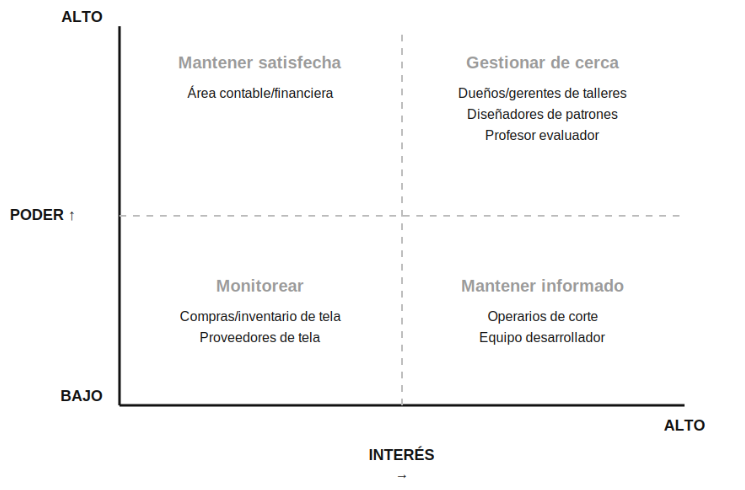

# Sistema Inteligente de Gestión de Mermas y Optimización de Corte Textil mediante IA

**Curso:** ISW-912 Administración de Proyectos Informáticos  
**Periodo:** III Cuatrimestre 2026  
**Proyecto:** Optimización del corte textil y reducción del desperdicio de tela

**Estudiantes:** María Jimena Jara Rojas y María Fernanda Sibaja Campos  
**Profesora:** Yesenia Calvo Araya  
**Sede:** Sede Regional de San Carlos

## Historial de versiones

| Versión | Semana | Fecha | Descripción |
|---|---|---|---|
| 1.0 | Clase 1 | 16/09/2026 | Acta de constitución en borrador, Product Goal y Scrum Team. |
| 2.0 | Clase 2 | 23/09/2026 | Contexto organizacional, entorno, restricciones y mapa de interesados. |
| 3.0 | Clase 3 | 30/09/2026 | Ciclo de vida y planificación del primer Sprint. |
| 4.0 | Clase 4 | 07/10/2026 | Product Backlog inicial, Sprint Backlog y mecanismo de seguimiento. |
| 5.0 | Clase 5 | 14/10/2026 | Alcance, historias de usuario con criterios de aceptación y Definition of Done. |
| 6.0 | Clase 6 | 21/10/2026 | Matriz de estimación, cronograma de entregas y presupuesto. |
| 7.0 | Clase 7 | 01/11/2026 | Plan de comunicaciones, tablero en Jira, replanificación a 4 Sprints y 11 historias, y DoD v1.1. |

## Contenido

- [Historial de versiones](#historial-de-versiones)
- [Definición del proyecto](#definición-del-proyecto)
- [Acta de constitución y Product Goal](#acta-de-constitución-y-product-goal)
- [Definición del Scrum Team](#definición-del-scrum-team)
- [Contexto organizacional y restricciones](#contexto-organizacional-y-restricciones)
- [Análisis de entorno](#análisis-de-entorno-eefs)
- [Taller de interesados del proyecto](#taller-de-interesados-del-proyecto)
- [Ciclo de vida y primer Sprint](#ciclo-de-vida-y-primer-sprint)
- [Alcance y Product Backlog priorizado](#alcance-y-product-backlog-priorizado)
- [Sprint Backlog y mecanismo de seguimiento](#sprint-backlog-y-mecanismo-de-seguimiento)
- [Historias de usuario](#historias-de-usuario)
- [Definition of Done v1.1](#definition-of-done-v11)
- [Estimación de subtareas del Sprint 1](#estimación-de-subtareas-del-sprint-1)
- [Matriz de estimación](#matriz-de-estimación)
- [Cronograma de entregas y costos](#cronograma-de-entregas-y-costos)
- [Plan de comunicaciones y tablero de trabajo](#plan-de-comunicaciones-y-tablero-de-trabajo)

---

## Definición del proyecto
**Sección 00 · Semana 1**

### Tema/Nombre

Sistema Inteligente de Gestión de Mermas y Optimización de Corte Textil mediante IA

### Estudiantes

María Jimena Jara Rojas y María Fernanda Sibaja Campos

### Problema

Las empresas y negocios dedicados a la confección de prendas necesitan utilizar grandes cantidades de tela para fabricar diferentes productos. Una distribución poco eficiente de los patrones durante el proceso de corte puede generar desperdicio de material, aumentar los costos de producción y dificultar el control sobre la cantidad de tela utilizada.

Actualmente, la planificación del corte puede realizarse de manera manual o mediante herramientas que no siempre consideran de forma integral las dimensiones de la tela, las cantidades requeridas, los diferentes tamaños de las prendas y las características de los patrones. Esto puede provocar un mayor porcentaje de material sobrante y dificultar la toma de decisiones antes de iniciar la producción.

El problema puede presentarse tanto en empresas de confección de gran volumen como en emprendimientos, marcas de ropa y negocios que producen cantidades menores de prendas.

### Proyecto propuesto

> **Visión del producto.** Esta sección describe el producto completo al que se aspira. Lo que se construye en los cuatro Sprints del proyecto se define en [Alcance y Product Backlog priorizado](#alcance-y-product-backlog-priorizado); funciones como la importación DXF/SVG, la fotografía de moldes, el No-Fit Polygon o la evaluación con ESICUP quedan en Fuera del alcance.

#### Descripción general

Desarrollar una plataforma web adaptable a dispositivos móviles que permita gestionar y optimizar el uso de tela durante la planificación de producción de prendas.
El sistema permitirá registrar los rollos de tela disponibles, sus dimensiones, características y cantidades requeridas para una producción. También permitirá cargar o registrar los patrones de las prendas y las cantidades necesarias de cada pieza.
Mediante algoritmos de optimización e Inteligencia Artificial (principalmente un algoritmo genético, apoyado en cálculos geométricos y en una heurística de colocación), el sistema analizará diferentes posibilidades de distribución de los patrones sobre la tela y propondrá una alternativa que busque maximizar el aprovechamiento del material y reducir el desperdicio.

#### Visualización de resultados

La plataforma mostrará visualmente la distribución propuesta y proporcionará información como:

- Cantidad de tela requerida.
- Porcentaje de aprovechamiento.
- Cantidad estimada de desperdicio.
- Cantidad de prendas que pueden producirse.
- Comparación entre diferentes alternativas de distribución.
- Estimación del costo asociado al material desperdiciado.
- Historial de producciones y desperdicios.

#### Usuarios de la plataforma

Además, contará con diferentes tipos de usuarios para permitir que pueda ser utilizada por emprendimientos, marcas de ropa, talleres y empresas de confección de mayor escala.

#### Registro de prendas y patrones

Cuando un cliente nuevo quiere agregar una prenda que el sistema aún no conoce, el sistema no depende de un catálogo cerrado. Cada pieza de la prenda se representa internamente como un contorno geométrico (un polígono con muchos puntos), lo que permite manejar desde un rectángulo hasta una forma curva, asimétrica o irregular. Para que cualquier cliente pueda cargar sus prendas, el sistema ofrece cuatro métodos:

#### Métodos de carga

- Plantillas con medidas. Para formas comunes (rectángulos, trapecios, círculos, mangas, cuellos, bolsillos), el usuario elige una plantilla e ingresa las medidas. Es el método más rápido para prendas sencillas.
- Importación de archivos de patrones. Si el cliente ya diseña sus patrones en programas de patronaje o diseño (como los que exportan archivos DXF o SVG), los sube directamente y el sistema extrae el contorno de cada pieza. Es el método más exacto para formas complejas.
- Fotografía o escaneo del patrón en papel. Para talleres y emprendimientos que usan moldes de papel, el usuario coloca el molde sobre un fondo que contraste, junto a una regla o marca de referencia, y lo fotografía con el celular. Un módulo de visión por computadora detecta el contorno, lo convierte a las medidas reales usando la referencia y lo muestra al usuario para que lo revise y ajuste.
- Editor de dibujo. El usuario dibuja la pieza con puntos y curvas, o corrige un contorno importado o detectado. Permite crear formas exóticas desde cero o ajustar detalles.

#### Proceso de registro

Sea cual sea el método, el proceso para agregar una prenda nueva sigue estos pasos:

1. El cliente crea la prenda (nombre, tipo y tallas) y agrega cada una de sus piezas por alguno de los cuatro métodos.
2. El sistema valida la geometría de cada pieza: que el contorno esté cerrado, que no se cruce consigo mismo, que la escala sea correcta y que la pieza quepa en el ancho de la tela disponible. Si hay un problema, muestra un mensaje claro para corregirlo.
3. El cliente indica las restricciones de cada pieza: dirección del hilo, rotaciones permitidas (ninguna, 180 grados o libre), margen de costura, si la pieza se corta en espejo (izquierda y derecha) y si la tela tiene sentido, pelo o estampado.
4. El cliente define las cantidades por pieza y por talla. Para otras tallas, puede cargar cada talla o aplicar una regla de escalado (gradación) sobre la talla base.
5. El sistema muestra una vista previa de las piezas y ejecuta una prueba de distribución sobre una tela de ejemplo para confirmar que la prenda funciona.
6. El cliente aprueba la prenda y esta se guarda en su biblioteca, con control de versiones, para reutilizarla en futuras órdenes de producción sin volver a cargarla.

#### Formas y características admitidas

El sistema debe soportar los siguientes tipos de formas y características:

- Formas rectas y geométricas: rectángulos, trapecios y triángulos.
- Formas curvas: cuellos, sisas, mangas, bajos redondeados y círculos completos o medios círculos.
- Formas cóncavas y asimétricas, con entradas y salidas en el contorno.
- Formas con huecos internos, por ejemplo una abertura dentro de la pieza.
- Piezas simétricas o en espejo, y piezas con dirección de hilo obligatoria.
- Piezas con estampado o cuadros que deben coincidir entre sí.
- Formas exóticas o de diseño (capas, volantes, cortes en espiral, drapeados), que se manejan como contornos irregulares.

El algoritmo de distribución trabaja con estos contornos reales, sin simplificarlos a cajas rectangulares, y considera las restricciones definidas para cada pieza. La Inteligencia Artificial (el algoritmo genético) interviene en la búsqueda y recomendación de las mejores alternativas de distribución; la detección del contorno a partir de fotografías se realiza con técnicas de visión por computadora.

#### Método de optimización: cómo se acomodan las piezas en la tela

Acomodar piezas irregulares sobre una tela sin desperdiciar es un problema conocido como nesting (empaquetado bidimensional de formas irregulares). No tiene una solución exacta que se calcule en un tiempo razonable, por lo que se resuelve con heurísticas y metaheurísticas, que son técnicas de Inteligencia Artificial clásica. El sistema propone una solución de buena calidad, no necesariamente la óptima, y la compara con otras alternativas. La solución se organiza en cuatro capas:

- Geometría de las piezas. Cada pieza es un polígono. Para saber si dos piezas pueden estar juntas sin traslaparse, se usa el No-Fit Polygon (NFP), que calcula todas las posiciones en las que una pieza toca a otra sin invadirla. Se puede implementar con librerías de geometría como Shapely y pyclipper.
- Colocación de las piezas. Dados un orden y una rotación para cada pieza, el sistema las coloca una por una con la heurística Bottom-Left: cada pieza se ubica lo más abajo y a la izquierda posible dentro del ancho del rollo. Esto genera una distribución completa, cuya calidad depende del orden y de las rotaciones elegidas.
- Búsqueda de la mejor distribución con un algoritmo genético. Este es el componente principal de Inteligencia Artificial. Funciona así:
  - Cromosoma: el orden de las piezas y la rotación de cada una (por ejemplo, 0 o 180 grados cuando la tela tiene dirección).
  - Aptitud (fitness): el porcentaje de aprovechamiento de la tela o, equivalentemente, el largo de tela consumido. Mientras menos tela se use, mejor es la solución.
  - Proceso: se genera una población de distribuciones al azar, se evalúa cada una con la colocación Bottom-Left, se combinan las mejores (cruce), se introducen cambios aleatorios (mutación) y se repite durante muchas generaciones hasta que la mejora se estabiliza.
  - Herramientas: la librería DEAP de Python para el algoritmo genético. Existen proyectos abiertos de nesting, como SVGnest y Deepnest, que usan un enfoque similar (NFP más algoritmo genético), lo que respalda la viabilidad de la técnica. Como alternativas de la misma familia se pueden evaluar el recocido simulado y la búsqueda tabú.

#### Tipo de Inteligencia Artificial utilizada

La Inteligencia Artificial de este proyecto es de tipo búsqueda y optimización (computación evolutiva), una rama reconocida de la IA. No se utilizan modelos de lenguaje ni redes neuronales, y el algoritmo genético no requiere datos de entrenamiento: optimiza cada orden de producción desde cero, lo que lo hace adecuado para un problema donde cada caso es distinto. El aprendizaje automático con datos históricos queda como una ampliación futura, una vez que el sistema haya acumulado información de producciones.

#### Visión por computadora y ampliaciones futuras

Para cargar patrones desde una fotografía se utiliza OpenCV (segmentación y detección de contornos), y como opción más avanzada un modelo de segmentación. En una etapa posterior, con el historial de producciones, un modelo de aprendizaje automático podría predecir el desperdicio esperado o sugerir un buen orden inicial para prendas similares.

#### Evaluación de resultados

Se comparará el porcentaje de aprovechamiento obtenido por el algoritmo genético contra una línea base simple (colocar las piezas de mayor a menor sin optimizar) y contra un acomodo manual, usando los mismos patrones y la misma tela. También se podrán utilizar conjuntos de datos públicos de referencia para este tipo de problema, como los del grupo ESICUP, para comparar con resultados conocidos.

### Valor esperado

Se espera proporcionar una herramienta que facilite la planificación del corte textil, permita tomar decisiones basadas en datos y contribuya a disminuir el desperdicio de tela.

El sistema también permitirá llevar un mejor control del consumo de materiales y generar información histórica que ayude a identificar patrones de desperdicio y oportunidades de mejora.

A largo plazo, la plataforma podría ampliarse con módulos de gestión de producción, control de inventario, control de calidad mediante visión artificial, cálculo de costos, proveedores y conexión entre empresas que requieren producción y empresas que ofrecen capacidad de confección.

### Objetivos

#### Objetivo general

Desarrollar una plataforma web para la planificación y optimización del corte de patrones textiles, utilizando un algoritmo genético como técnica de Inteligencia Artificial, con el propósito de mejorar el aprovechamiento de la tela y reducir el desperdicio durante la producción de prendas.

#### Objetivos específicos

- Diseñar e implementar una plataforma web adaptable a dispositivos móviles que permita registrar y gestionar rollos de tela, prendas, patrones y órdenes de producción, considerando las dimensiones y restricciones necesarias para el proceso de corte.
- Desarrollar un módulo de optimización basado en un algoritmo genético, apoyado en cálculos geométricos y una heurística de colocación, que genere y visualice diferentes distribuciones de patrones sobre la tela y permita calcular el porcentaje de aprovechamiento, el desperdicio y el consumo estimado de material.
- Evaluar el funcionamiento del sistema mediante casos de prueba con diferentes patrones, cantidades y dimensiones de tela, comparando los resultados obtenidos mediante el algoritmo de optimización con una línea base de distribución y, cuando sea posible, con un acomodo manual.

---

## Acta de constitución y Product Goal
**Sección 00 · Semana 1**

El acta define el propósito, los entregables y las condiciones iniciales del proyecto. Su aprobación está pendiente.

| Elemento | Definición propuesta |
|---|---|
| Nombre | Sistema Inteligente de Gestión de Mermas y Optimización de Corte Textil mediante IA |
| Justificación | La distribución ineficiente de patrones puede desperdiciar tela y aumentar el costo de producción. Se propone apoyar la decisión antes del corte mediante una distribución válida e indicadores comparables. |
| Propósito | Construir y evaluar un prototipo académico que conecte la colocación geométrica de piezas, su optimización y la visualización de resultados. |
| Equipo responsable | María Jimena Jara Rojas y María Fernanda Sibaja Campos; distribución de responsabilidades en la definición del Scrum Team. |
| Cliente y patrocinio | No hay empresa cliente ni patrocinador externo confirmado. La profesora evalúa el proyecto académico; esto no implica patrocinio financiero ni validación comercial. |
| Entregables | Expediente actualizado, repositorio con código y evidencias, prototipo ejecutable, informe final y demostración del incremento. |
| Inicio y cierre | Inicio: 16/09/2026. Cierre del proyecto: 07/12/2026. La construcción se organiza en cuatro Sprints del 14/10 al 07/12/2026. |
| Recursos | Dos estudiantes, equipos existentes y herramientas de software disponibles; capacidad e importes propuestos en el plan temporal y de costos. |
| Riesgos iniciales | Complejidad geométrica, sobreestimación de capacidad, falta de patrones reales e integración tardía. Se mitigan con un alcance acotado, datos sintéticos y entregas por Sprint. El registro detallado se desarrollará en la semana correspondiente. |
| Autoridad y cambios | La Product Owner propone el orden y el alcance; las Developers estiman y organizan la implementación. Los cambios que afecten la evaluación se consultan a la profesora. Toda variación se documenta con su impacto en alcance, fecha y costo. |
| Estado de aprobación | Borrador pendiente de revisión por el equipo y la profesora. |

### Product Goal

Permitir que una persona encargada del corte textil configure un caso sencillo, obtenga una distribución de piezas sin traslapes y compare el aprovechamiento de una colocación base con una alternativa optimizada, mediante una plataforma web demostrable al cierre del proyecto, el 07/12/2026.

### Criterios de éxito del proyecto

1. Ejecutar de principio a fin tres casos sintéticos identificados y reproducibles, incluyendo rectángulos, trapecios y una pieza cóncava.
2. Mantener todas las piezas dentro del rollo y sin intersecciones de área; ante entradas inválidas, informar el problema sin presentar una solución como válida.
3. Mostrar el largo consumido, el aprovechamiento y el desperdicio usando las mismas unidades y fórmulas para ambas alternativas.
4. Comparar la línea base con el algoritmo genético bajo las mismas condiciones, registrando semilla, parámetros y resultados. No se promete un porcentaje de ahorro ni una solución óptima.
5. Entregar las historias del MVP que cumplan sus criterios y la DoD, junto con instrucciones de ejecución, evidencias e informe. Las funciones incompletas se declaran pendientes.

---

## Definición del Scrum Team
**Sección 01 · Semana 1**

| Rol | Integrante asignada (propuesta) | Responsabilidades hasta el cierre del proyecto (07/12/2026) |
|---|---|---|
| Product Owner | María Jimena Jara Rojas | Definir y comunicar la meta del producto, ordenar el Product Backlog y priorizar las funciones según las necesidades de los usuarios y el tiempo disponible |
| Scrum Master | María Fernanda Sibaja Campos | Promover la aplicación de Scrum, facilitar los eventos cuando sea necesario, ayudar a resolver impedimentos y apoyar la mejora de la efectividad del equipo |
| Developers | María Jimena Jara Rojas y María Fernanda Sibaja Campos | Analizar, diseñar, programar, integrar, probar y documentar la solución; organizar el trabajo técnico para alcanzar la meta de cada Sprint y asegurar la calidad del incremento |

---

## Contexto organizacional y restricciones
**Secciones 02–03 · Semana 2**

El escenario de referencia es un taller pequeño de confección que planifica sus cortes con patrones y rollos de tela. El prototipo se validará inicialmente con casos sintéticos; la validación con un taller real queda pendiente.

### Organización y flujo de trabajo

En el escenario propuesto, la persona dueña o encargada decide qué producir y valida el uso de material; la patronista prepara las piezas y restricciones; los operarios ejecutan el corte. El prototipo apoya la planificación y no controla maquinaria. El flujo previsto es: definir tela y piezas → validar entradas → generar línea base → optimizar → comparar → revisar la propuesta antes del corte.

El equipo académico se organiza alrededor del proyecto, con dos integrantes que comparten desarrollo. La autoridad comercial del taller y la evaluación docente son externas al equipo. Las necesidades atribuidas a los interesados son hipótesis hasta obtener retroalimentación real.

**Estructura organizacional:** un taller de confección pequeño suele tener una estructura **funcional**: la persona dueña decide y cada área (patronaje, corte, compras) responde a ella, sin un rol dedicado a proyectos. El equipo del proyecto, en cambio, trabaja con una estructura **orientada a proyectos**: se autoorganiza alrededor del Product Goal, sin jerarquía interna. Por eso las decisiones de uso del sistema en el taller dependen de la dueña o el encargado, y las decisiones técnicas y de alcance quedan dentro del Scrum Team.

| Restricción | Aplicación al proyecto |
|---|---|
| Fecha | Proyecto del 16/09/2026 al 07/12/2026; construcción en cuatro Sprints del 14/10 al 07/12. |
| Personal y capacidad | Solo dos Developers junior, con 20 horas semanales cada una (velocidad estimada de 19 puntos por Sprint). |
| Infraestructura | Demostración local en un equipo existente. No depender de un alojamiento de pago o de conexión durante la demo. |
| Datos | Emplear casos sintéticos mientras no existan patrones reales autorizados; no afirmar validación industrial. |
| Geometría del MVP | Polígonos simples en centímetros, sin huecos ni escalado de tallas; piezas completas, cantidades enteras positivas y ancho positivo. |
| Producto | Un único escenario de taller y una sesión local; sin gestión de múltiples empresas, cuentas o permisos en el MVP. |
| Presupuesto | No hay financiamiento confirmado. Los costos documentados son una simulación académica, sin autorización de compra. |

### Activos disponibles y decisiones

Se reutilizan la plantilla de historias de usuario de Materia, las presentaciones del curso, el MD existente, el mapa de interesados y los trabajos previos. El repositorio y el historial de versiones permiten mantener trazabilidad. No se asume que exista una política o un procedimiento propio de un taller cliente.

La Product Owner registra propuestas de cambio con fecha, motivo, ítems afectados, efecto temporal y económico y decisión. Las Developers evalúan viabilidad; la Scrum Master facilita la discusión de impedimentos. Si el cambio modifica compromisos académicos, se solicita criterio docente antes de presentarlo como aceptado. Este mecanismo inicial se ampliará con las responsabilidades y comunicación de las semanas posteriores.

---

## Análisis de entorno (EEFs)
**Sección 02 · Semana 2**

### Factores ambientales que impactan el proyecto

| Factor ambiental | Condición conocida o por verificar | Impacto en la solución | Respuesta prevista |
|---|---|---|---|
| Calendario y requisitos académicos | El proyecto va del 16/09 al 07/12/2026 y su Expediente se revisa semana a semana en el curso | Limitan el tiempo y condicionan los entregables | Priorizar las funciones y ajustar la planificación al calendario oficial |
| Infraestructura tecnológica disponible | Verificar capacidad de las computadoras, conexión y alojamiento disponible | Puede limitar la ejecución del algoritmo genético y las demostraciones | Realizar pruebas de rendimiento en los equipos disponibles y evaluar ejecución local |
| Acceso a usuarios del sector textil | Confirmar disponibilidad de dueños, patronistas y operarios para entrevistas y pruebas | Condiciona la validación de necesidades y resultados | Coordinar su participación y documentar las limitaciones si no se consigue acceso |
| Disponibilidad y uso de patrones | Confirmar formatos, medidas y permisos para utilizar patrones reales | Determina los casos de prueba y las posibilidades de publicar ejemplos | Utilizar material autorizado o casos sintéticos identificados como tales |
| Cultura y procesos del taller | Investigar cómo se planifican los cortes y la disposición a incorporar herramientas digitales | Influye en la facilidad de uso y aceptación del sistema | Validar el flujo de trabajo con usuarios antes de asumir necesidades específicas |
| Distribución geográfica y conectividad | Modalidad de trabajo del equipo y ubicación de los usuarios por confirmar | Puede dificultar coordinación, entrevistas y demostraciones | Acordar canales de comunicación y alternativas de reunión |
| Privacidad y confidencialidad | Verificar las condiciones aplicables a datos personales y patrones comerciales que se compartan | Puede restringir acceso, almacenamiento y publicación de información | Minimizar datos y acordar permisos antes de incorporar información del taller |
| Recursos económicos y licencias disponibles | Presupuesto y acceso a servicios por confirmar | Condicionan herramientas, alojamiento y despliegue | Priorizar recursos disponibles y evaluar costos antes de contratar servicios |

---

## Taller de interesados del proyecto
**Sección 03 · Semana 2**

### Identificación y registro de interesados

Para el registro utilizamos una escala de **1 a 5** para poder e interés. Consideramos **1 a 3 como bajo** y **4 a 5 como alto**.

| Interesado | Rol / relación | Necesidad | Poder | Interés | Actitud | Estrategia | Responsable |
|---|---|---|---:|---:|---|---|---|
| Dueños/gerentes de talleres y empresas de confección | Clientes y posibles usuarios decisores | Reducir el desperdicio de tela y bajar costos de producción | 5 | 5 | Favorable | Gestionar de cerca | Jimena |
| Diseñadores de patrones / patronistas | Usuarios especializados del sistema | Que el sistema interprete correctamente sus patrones, incluidas las formas irregulares | 4 | 5 | Favorable | Gestionar de cerca | Jimena |
| Profesora evaluadora | Evaluadora del proyecto | Que el proyecto cumpla los objetivos y la metodología del curso | 5 | 4 | Neutral | Gestionar de cerca | Fernanda |
| Operarios de corte | Usuarios del resultado del sistema | Recibir instrucciones de distribución claras y aplicables en planta | 2 | 4 | Mixta | Mantener informado | Fernanda |
| Equipo desarrollador (nosotras) | Responsables del desarrollo | Mantener un alcance manejable durante el tiempo disponible del curso | 3 | 5 | Favorable | Mantener informado | Fernanda |
| Área contable/financiera del cliente | Área que revisa el impacto económico | Ver el ahorro real en material y valorar la inversión | 4 | 2 | Neutral | Mantener satisfecha | Jimena |
| Encargados de compras/inventario de tela | Responsables de controlar materiales | Registrar correctamente los rollos de tela disponibles | 2 | 3 | Neutral | Monitorear | Jimena |
| Proveedores de tela | Proveedores externos relacionados con el material | Mantener su volumen de venta | 1 | 2 | Neutral | Monitorear | Jimena |

La columna **Responsable** indica qué integrante gestiona la relación con cada interesado; coincide con el plan de comunicaciones.

### Justificación de los casos discutibles

No todos los valores fueron evidentes desde el inicio. Estos fueron los casos que más tuvimos que analizar:

- **Diseñadores de patrones (poder 4):** al inicio pensamos asignarles menos poder porque no son quienes pagan por el sistema. Sin embargo, su participación es importante porque un patrón mal cargado o que el sistema no interprete correctamente puede afectar el resultado de la optimización. Por eso consideramos que tienen un poder alto dentro de la operación del sistema.
- **Equipo desarrollador (poder 3, interés 5):** el interés es alto porque somos responsables directamente del desarrollo. El poder se mantiene en un nivel medio porque las decisiones importantes de alcance también dependen de los requisitos del curso y de las condiciones del proyecto.
- **Área contable/financiera (interés 2):** aunque el proyecto busca reducir costos, esta área no participa constantemente en el desarrollo. Su participación sería más importante al analizar presupuesto, ahorro o resultados económicos.
- **Proveedores de tela (poder 1):** podrían verse afectados si disminuye el desperdicio y, por lo tanto, cambia el consumo de tela. Sin embargo, no tienen capacidad directa para aprobar, modificar o bloquear las decisiones del proyecto.

### Mapa Poder-Interés

El mapa utiliza la misma escala de 1 a 5. Para definir los cuadrantes consideramos de **1 a 3 como bajo** y de **4 a 5 como alto**.

	

Distribución por cuadrante:

| Cuadrante | Estrategia | Interesados |
|---|---|---|
| Poder alto, interés alto | Gestionar de cerca | Dueños/gerentes de talleres, diseñadores de patrones, profesora evaluadora |
| Poder alto, interés bajo | Mantener satisfecha | Área contable/financiera |
| Poder bajo, interés alto | Mantener informado | Operarios de corte, equipo desarrollador |
| Poder bajo, interés bajo | Monitorear | Compras/inventario de tela, proveedores de tela |

### Preguntas de análisis del grupo

#### ¿A quién debemos involucrar primero?

Debemos involucrar primero a los **dueños o gerentes de talleres y empresas de confección**, porque pueden validar si el sistema realmente responde al problema que se quiere resolver. También es importante involucrar desde el inicio a los **diseñadores de patrones**, ya que conocen directamente los tipos de patrones y las dificultades que el sistema debe manejar.

#### ¿Quién puede bloquear una decisión?

Los **dueños o gerentes** y la **profesora evaluadora** tienen capacidad para condicionar decisiones importantes. Los primeros pueden decidir si el sistema resulta útil para su operación, mientras que la profesora establece los criterios que debe cumplir el proyecto dentro del curso.

#### ¿Quién necesita información frecuente?

Los **dueños o gerentes**, los **diseñadores de patrones**, la **profesora evaluadora** y el **equipo desarrollador** necesitan información frecuente sobre avances, pruebas y cambios. Los operarios también deben recibir información cuando existan cambios que afecten las instrucciones de corte.

#### ¿Qué interesado estamos subestimando?

Consideramos que los **operarios de corte** podrían ser el interesado que más fácilmente se subestima. Aunque tienen un poder menor, son quienes podrían utilizar directamente las instrucciones generadas por el sistema. Si estas no son claras o prácticas, el resultado puede ser difícil de aplicar en la operación real.

#### ¿Qué conflicto de expectativas puede aparecer?

Puede aparecer un conflicto entre la necesidad de los **dueños o gerentes de obtener ahorro y resultados** y las limitaciones del **equipo desarrollador**, especialmente por el tiempo disponible para desarrollar y probar la inteligencia artificial. También puede existir una diferencia entre lo que los **patronistas** esperan que el sistema interprete y lo que técnicamente sea posible implementar dentro del alcance del curso.

### Los tres interesados críticos

#### 1. Dueños/gerentes de talleres y empresas de confección

Son quienes pueden validar el valor práctico del sistema y decidir si resulta útil para su operación. Planeamos involucrarlos mediante demostraciones periódicas del prototipo, recopilando retroalimentación sobre las funciones y verificando que el sistema responda al problema del desperdicio de tela.

#### 2. Diseñadores de patrones / patronistas

Participan directamente en una de las partes más importantes del sistema. Realizaremos pruebas con patrones reales, incluyendo formas irregulares, y solicitaremos retroalimentación sobre las formas de cargar las piezas incluidas en el proyecto (plantillas y coordenadas). Su opinión sobre la importación de archivos DXF/SVG, las fotografías o el dibujo se registrará para fases posteriores, porque están fuera del alcance.

#### 3. Profesora evaluadora

Sus criterios son importantes porque el proyecto debe cumplir con los objetivos y metodología establecidos para el curso. Planeamos mostrar avances en las entregas correspondientes y consultar oportunamente cuando existan dudas sobre el alcance o la metodología.

### ¿Predictivo, adaptativo o híbrido?

El proyecto se gestionará con un enfoque **híbrido**.   

El alcance general fue definido desde el Trabajo #1 y el curso tiene una fecha de entrega establecida. Por esta razón, algunas partes pueden planificarse anticipadamente, como los módulos relacionados con tela, patrones y órdenes de producción.

Sin embargo, el módulo de optimización presenta mayor incertidumbre. El algoritmo genético y la heurística de colocación requieren pruebas, ajustes y retroalimentación; la visión por computadora quedó fuera del alcance precisamente por esa incertidumbre. Es posible que debamos modificar algunos aspectos conforme obtengamos resultados de las pruebas con distintos tipos de piezas.

Por estas características, el enfoque híbrido se adapta al contexto del proyecto: permite mantener una planificación estable para los elementos definidos y, al mismo tiempo, utilizar ciclos de prueba y adaptación en las partes que presentan mayor incertidumbre.

---

## Ciclo de vida y primer Sprint
**Sección 04 · Semana 3**

Se mantiene el enfoque híbrido justificado en el análisis de interesados: hitos académicos fijos y construcción iterativa del producto.

| Fase | Periodo de referencia | Resultado o condición de salida |
|---|---|---|
| Inicio | Semanas 1–2, 16/09–30/09 | Problema, equipo, meta, contexto e interesados documentados; supuestos identificados. |
| Preparación | Semanas 3–4, 30/09–14/10 | Ciclo de vida, backlog inicial y plan del primer Sprint. |
| Construcción incremental | Sprints 1–4, 14/10–07/12 | Motor genético, captura de piezas, ejecución web, visualización y órdenes; inspección y adaptación en cada Sprint. |
| Verificación y consolidación | Continua; énfasis en el Sprint 4, 25/11–07/12 | Casos reproducibles, integración, expediente, evidencias y preparación de demo. |
| Cierre | 07/12/2026 | Demo, informe final, alcance logrado y pendiente, lecciones aprendidas y entrega del repositorio. |

Las fechas límite de periodos consecutivos representan el cambio de fase; no agregan días de trabajo. La verificación acompaña al desarrollo y no se aplaza íntegramente al cierre.

### Plan del primer Sprint

- **Periodo:** 14/10/2026 al 28/10/2026; duración de dos semanas.
- **Sprint Goal:** obtener un trazo válido y reproducible de piezas sobre un rollo de ancho definido, que respete las rotaciones permitidas, con sus indicadores y una línea base de comparación.
- **Selección:** HU-01 a HU-04, 19 puntos de una capacidad estimada de 19. Se eligen porque sin colocación válida, indicadores y línea base no se puede verificar la mejora del optimizador; la plataforma web (HU-04) se trabaja en paralelo para no retrasar la captura de piezas.
- **Incremento previsto:** motor ejecutable localmente con imagen del trazo, indicadores, línea base y rotaciones, y la estructura web navegable.
- **Entrada al Sprint:** disponer de ejemplos de polígonos, unidades comunes, ancho de rollo y criterios de aceptación. Revisar el plan si falta alguno.
- **Situación al corte documental:** las historias y tareas están descritas; no se aportan código ni resultados que acrediten su terminación.

Cada Sprint comienza con Planning para revisar meta y capacidad. Durante su ejecución se inspecciona el tablero mediante Daily Scrum. La Review examina el incremento contra criterios y DoD; la Retrospective define una mejora para el siguiente Sprint. En el cierre de un Sprint y apertura del siguiente se registra la transición sin duplicar capacidad.

---

## Alcance y Product Backlog priorizado
**Secciones 05–06 · Semanas 4–5**

El Product Backlog contiene las historias que caben en los cuatro Sprints del proyecto. Lo que la visión del producto describe y no cabe se declara en Fuera del alcance.

### Alcance del proyecto (16/09/2026 – 07/12/2026)

El proyecto va del **16/09/2026 al 07/12/2026**. La construcción se organiza en **cuatro Sprints entre el 14/10 y el 07/12**, con **11 historias de usuario y 66 puntos**, que es lo que permite la capacidad del equipo (ver la matriz de estimación). Las historias cubren los tres objetivos específicos:

- **Objetivo 1:** plataforma web adaptable; registro de rollos, prendas con tallas, piezas por plantillas rectas y curvas o por coordenadas, cantidades y órdenes de producción.
- **Objetivo 2:** colocación sin traslapes, rotaciones permitidas, algoritmo genético, indicadores de largo, aprovechamiento y desperdicio, y visualización de la distribución.
- **Objetivo 3:** comparación de la línea base, el algoritmo genético y un acomodo manual con los mismos datos.

La plataforma funciona para un taller de referencia, en ejecución local, con una base de datos local y sin cuentas de usuario.

### Fuera del alcance

Las siguientes capacidades forman parte de la visión del producto descrita al inicio, pero no caben en los cuatro Sprints y no tienen historias en este backlog:

- Cuentas de usuario, tipos de cliente, roles y separación por empresa.
- Importación de archivos DXF y SVG, fotografía de moldes con visión por computadora y editor de dibujo.
- Gradación de tallas, biblioteca de prendas y control de versiones.
- Piezas con huecos internos, margen de costura, piezas en espejo y coincidencia de estampados.
- Inventario de rollos, costo del desperdicio, plano de corte imprimible, historial y reportes.
- Colocación con No-Fit Polygon y evaluación con instancias ESICUP.

Tampoco se incluyen la predicción con aprendizaje automático, la gestión de producción, los proveedores, la operación en planta ni una garantía de ahorro real. Si se aprueba una fase posterior, estas capacidades se convertirán en historias y se estimarán con la velocidad observada.

### Alcance del proyecto y aceptación

El trabajo comprende análisis, refinamiento, diseño de entradas y resultados, implementación, pruebas, integración, documentación, preparación de casos y demo, informe final y cierre. La estimación de cada historia incluye su diseño, pruebas y documentación, sin contarlos de nuevo como funcionalidades adicionales.

Cada historia se acepta contra sus criterios y la DoD. El equipo registra el resultado y la evidencia; las observaciones de la profesora y de los interesados se incorporan como cambios. La aceptación académica final corresponde a la profesora. Si no participa un taller real, se declara esa limitación en el informe.

### Product Backlog ordenado

El orden de las filas expresa la prioridad. Cada historia tiene el identificador **HU-xx**, que también es su ítem del Product Backlog. Puntos en escala Fibonacci (ver la matriz de estimación). Una historia entra a un Sprint solo si mide 8 puntos o menos.

**Épicas:** E1 Motor de optimización (IA) · E2 Registro de telas y piezas · E3 Plataforma web y resultados.

| Orden | ID | Historia resumida | Épica | Puntos | Prioridad | Sprint | Depende de |
|---:|---|---|---|---:|---|---|---|
| 1 | HU-01 | Colocación automática de piezas sin traslapes e imagen del trazo | E1 | 8 | Alta | Sprint 1 | — |
| 2 | HU-02 | Indicadores de aprovechamiento y desperdicio y línea base | E1 | 5 | Alta | Sprint 1 | HU-01 (datos de ejemplo) |
| 3 | HU-03 | Rotaciones permitidas y dirección del hilo | E1 | 3 | Alta | Sprint 1 | HU-01 |
| 4 | HU-04 | Plataforma web adaptable | E3 | 3 | Alta | Sprint 1 | — |
| 5 | HU-05 | Optimización con algoritmo genético | E1 | 8 | Alta | Sprint 2 | HU-01, HU-02, HU-03 |
| 6 | HU-06 | Registro y validación de piezas (plantillas rectas y coordenadas) | E2 | 8 | Alta | Sprint 2 | HU-04 |
| 7 | HU-07 | Rollos, prendas, tallas y cantidades | E2 | 8 | Alta | Sprint 3 | HU-04, HU-06 |
| 8 | HU-08 | Ejecución de la optimización desde la web | E3 | 5 | Alta | Sprint 3 | HU-05, HU-07 |
| 9 | HU-09 | Comparación de alternativas: línea base, genético y acomodo manual | E1 | 5 | Alta | Sprint 3 | HU-02, HU-05 |
| 10 | HU-10 | Piezas con plantillas curvas | E2 | 5 | Media | Sprint 4 | HU-06 |
| 11 | HU-11 | Resultados visuales y órdenes de producción | E3 | 8 | Alta | Sprint 4 | HU-08, HU-09 |

### Requisitos no funcionales y trazabilidad

| Requisito / origen | Historias y verificación |
|---|---|
| R-01: validez geométrica / problema y patronista | HU-01, HU-03, HU-05 y HU-06; pruebas de límites, traslapes y orientación. |
| R-02: medición comparable / objetivo de reducir merma | HU-02, HU-09 y HU-11; casos de área conocida, suma de porcentajes de 100 % con tolerancia de 0,01 puntos porcentuales por redondeo. |
| R-03: evaluación de IA / objetivo específico 3 | HU-02, HU-05 y HU-09; comparación de la línea base, el algoritmo genético y el acomodo manual en tres casos con parámetros registrados, sin declarar mejoras no medidas. |
| RNF-01: reproducibilidad / evaluación académica | HU-01, HU-05 y HU-08; versiones del entorno, datos, semilla y procedimiento documentados. |
| RNF-02: uso en distintos tamaños / visión web adaptable | HU-04 y HU-11; revisión de controles y visualización en 360 y 1280 píxeles. |
| RNF-03: ejecución acotada / capacidad del equipo | HU-08; límite configurable de generaciones y tiempo, inicialmente 30 segundos por caso de hasta 20 piezas. |
| RNF-04: datos y recuperación / escenario académico | Todas; casos sintéticos identificados, sin datos personales necesarios; los errores de entrada no cierran la aplicación ni se presentan como soluciones válidas. |

---

## Sprint Backlog y mecanismo de seguimiento
**Sección 05 · Semana 4**

- **Sprint Goal:** obtener un trazo válido y reproducible de piezas sobre un rollo de ancho definido, que respete las rotaciones permitidas, con sus indicadores y una línea base de comparación.
- **Fechas:** del 14/10/2026 al 28/10/2026.
- **Ítems seleccionados:** HU-01 a HU-04 (19 puntos), desglosadas en 18 tareas con responsables, dependencias y evidencia esperada. Los puntos de cada tarea se presentan en la sección de estimación de subtareas.

| Tarea | Historia | Responsable | Dependencia de trabajo | Estado | Evidencia esperada |
|---|---|---|---|---|---|
| T-01 | HU-01 | Jimena | Ninguna | Por hacer | Datos de piezas y rollo con unidades |
| T-02 | HU-01 | Fernanda | T-01 | Por hacer | Código de colocación |
| T-03 | HU-01 | Jimena | T-02 | Por hacer | Pruebas de traslapes y límites |
| T-04 | HU-01 | Fernanda | T-01; integración con T-02 | Por hacer | Caso de pieza demasiado ancha |
| T-05 | HU-01 | Jimena | T-02 | Por hacer | Comparación de dos ejecuciones |
| T-06 | HU-01 | Fernanda | T-02 | Por hacer | Imagen del trazo |
| T-07 | HU-01 | Jimena | T-03, T-04, T-05 y T-06 | Por hacer | Resultados de casos geométricos |
| T-08 | HU-02 | Fernanda | Distribución de ejemplo; luego T-02 | Por hacer | Cálculo del largo |
| T-09 | HU-02 | Jimena | T-08 y áreas de piezas | Por hacer | Cálculos de porcentajes |
| T-10 | HU-02 | Fernanda | T-08 y T-09 | Por hacer | Salida de indicadores y pruebas |
| T-11 | HU-02 | Jimena | T-02 | Por hacer | Orden de piezas por área |
| T-12 | HU-02 | Jimena | T-11 y T-09 | Por hacer | Indicadores de la línea base en tres casos |
| T-13 | HU-03 | Jimena | T-01 | Por hacer | Modelo de restricciones por pieza |
| T-14 | HU-03 | Fernanda | T-02 y T-13 | Por hacer | Colocación con orientaciones permitidas |
| T-15 | HU-03 | Jimena | T-14 | Por hacer | Pruebas de orientación y rechazo |
| T-16 | HU-04 | Fernanda | Ninguna | Por hacer | Proyecto web con navegación |
| T-17 | HU-04 | Jimena | T-16 | Por hacer | Capturas en 360 y 1280 píxeles |
| T-18 | HU-04 | Jimena | T-16 | Por hacer | Instrucciones de ejecución local |

### Verificación de la DoD por historia

| Historia | Cómo se verifica que cumple la DoD |
|---|---|
| HU-01 | Pruebas unitarias de límites, traslapes y reproducibilidad pasando; imagen del trazo de los tres casos sintéticos; cada pull request aprobado por la otra integrante. |
| HU-02 | Pruebas unitarias con casos de área conocida (100 % / 0 % y suma de 100 %); tabla de indicadores de la línea base en los tres casos. |
| HU-03 | Pruebas unitarias de orientación permitida y rechazo de violaciones; imagen que muestra piezas a 0° y 180°. |
| HU-04 | Revisión manual en 360 y 1280 píxeles con capturas; ejecución desde una copia limpia siguiendo las instrucciones del repositorio. |

### Tablero y eventos propuestos

El seguimiento diario se hace en el tablero de Jira (ver [tablero de trabajo](#tablero-de-trabajo)); la tabla del Sprint Backlog es su copia versionada en el repositorio. La columna Estado utiliza **Por hacer, En curso, En revisión y Terminada**, las mismas columnas del tablero de trabajo. En cada Daily Scrum se actualizan el estado, las dependencias y la evidencia; los impedimentos y sus acciones se anotan en el registro de seguimiento. Una tarea pasa a Terminada únicamente con su evidencia y revisión.

Con una dedicación de 20 horas semanales cada una, el Daily Scrum dura como máximo 15 minutos en cada día hábil: inspeccionar el avance hacia la meta, identificar impedimentos y ajustar el siguiente paso. Se limita a una tarea en curso por integrante (ver el tablero de trabajo) y se revisan primero las que bloquean a la otra.

La revisión de código corresponde a la otra integrante. En la Review se demuestra cada historia, se comprueban criterios y DoD y se registran observaciones; en la Retrospective se elige una mejora concreta. Las tareas no terminadas se reevalúan para el siguiente Sprint sin prolongar el actual y sin sumar puntos a la velocidad.

### Registro de seguimiento

| Fecha | Historia/tarea | Estado | Impedimento | Acción y responsable | Evidencia |
|---|---|---|---|---|---|
| 22/10/2026 | HU-01 y HU-02 / T-01 a T-10 | Planificado | Ninguno registrado | Ambas: mantener actualizado el tablero | Sprint Backlog |
| 01/11/2026 | Product Backlog | Replanificado | El backlog anterior solo detallaba dos historias y suponía 10 h semanales | Product Owner: backlog de 11 historias que caben en los cuatro Sprints; Developers: estimación con 20 h semanales cada una | Versión 7.0 del expediente |

---

## Historias de usuario
**Sección 06 · Semana 5**

Todas las historias siguen la plantilla de historias de usuario: título, plantilla clásica (Card), criterios de aceptación (Confirmation) en formato *Dado / cuando / entonces*, estimación y prioridad, notas adicionales y verificación INVEST. Cada una entrega valor visible a un rol, mide 8 puntos o menos para caber en un Sprint y tiene criterios comprobables.

**Roles:** *patronista* (diseña y carga las piezas), *encargado* (dueño o gerente del taller que planifica la producción) y *usuaria del taller* (cualquier persona que usa la plataforma).

### Historia de Usuario HU-01

#### Título

Colocación automática de piezas sobre el rollo de tela sin traslapes

#### Estructura o plantilla clásica (Card)

- **Como:** Patronista (persona encargada del trazo y el corte en un taller de confección).
- **Quiero:** Que el sistema acomode automáticamente las piezas de una prenda sobre un rollo de tela de ancho definido, respetando el contorno real de cada pieza.
- **Para:** Obtener un trazo de corte válido, sin piezas encimadas ni fuera de la tela, sin tener que acomodarlas a mano.

**Historia completa:** Como patronista, quiero que el sistema acomode automáticamente las piezas de una prenda sobre un rollo de tela de ancho definido, respetando el contorno real de cada pieza, para obtener un trazo de corte válido, sin piezas encimadas ni fuera de la tela, sin tener que acomodarlas a mano.

#### Criterios de aceptación (Confirmation)

1. Dado que existe un conjunto de piezas válidas de una prenda y un rollo con un ancho definido, cuando la patronista ejecuta la colocación, entonces todas las piezas quedan dentro del ancho del rollo.
2. Dado que se generó una distribución, cuando el sistema verifica la geometría de las piezas, entonces ningún par de piezas se traslapa (pueden tocarse por el borde).
3. Dado que se usan las mismas piezas y los mismos parámetros, cuando se ejecuta la colocación dos veces, entonces se obtiene exactamente la misma distribución.
4. Dado que una pieza es más ancha que el rollo, cuando se ejecuta la colocación, entonces el sistema informa qué pieza no cabe y no entrega una distribución inválida.
5. Dado que se generó una distribución, cuando la patronista solicita verla, entonces el sistema genera una imagen con cada pieza numerada en su posición sobre el rollo.

#### Estimación y prioridad

- **Prioridad:** Alta.
- **Estimación:** 8 puntos de historia (Fibonacci). Es la historia más grande del backlog y el máximo admitido en un Sprint.
- **Ítem del Product Backlog:** HU-01, Sprint 1 (14/10/2026 al 28/10/2026).

#### Notas adicionales o anexos

- **Diseños/Wireframes:** No aplica en este Sprint. El resultado se entrega como una imagen generada por el motor (tarea T-06); la pantalla web se construye en HU-11.
- **Notas técnicas:** La colocación usa la heurística Bottom-Left con geometría real de polígonos (Shapely). Se prueba con casos sintéticos: rectángulos, trapecios y una pieza cóncava.
- **Dependencias:** Ninguna previa. Es la base de HU-02, HU-03 y del algoritmo genético (HU-05).
- **Fuera de alcance:** El algoritmo genético (HU-05), las piezas con huecos internos y la colocación con No-Fit Polygon.
- **Definición de terminado:** La historia se considera terminada cuando cumple los criterios anteriores y la Definition of Done v1.1 del Expediente.

#### Verificación INVEST

- **Independiente:** No depende de otras historias; es el punto de partida del motor.
- **Negociable:** El algoritmo de colocación y la forma de verificar los resultados pueden discutirse con el equipo.
- **Valiosa:** Sin una colocación válida no existe un trazo utilizable en el taller.
- **Estimable:** El alcance está acotado a una heurística conocida y a casos de prueba definidos.
- **Pequeña:** Con 8 puntos ocupa cerca del 40 % de la velocidad estimada de 19 puntos por Sprint.
- **Testable:** Cada criterio se comprueba con pruebas automáticas o con la imagen generada.

### Historia de Usuario HU-02

#### Título

Indicadores de aprovechamiento y desperdicio y línea base de comparación

#### Estructura o plantilla clásica (Card)

- **Como:** Dueño o encargado de un taller de confección.
- **Quiero:** Ver el largo de tela consumido y los porcentajes de aprovechamiento y de desperdicio de una distribución, y obtener una colocación de referencia que ordene las piezas de mayor a menor área.
- **Para:** Saber qué tan eficiente es el acomodo, decidir cuánta tela usar antes de cortar y tener un punto de comparación sin optimización.

**Historia completa:** Como dueño o encargado de un taller de confección, quiero ver el largo de tela consumido y los porcentajes de aprovechamiento y de desperdicio de una distribución, y obtener una colocación de referencia que ordene las piezas de mayor a menor área, para saber qué tan eficiente es el acomodo, decidir cuánta tela usar antes de cortar y tener un punto de comparación sin optimización.

#### Criterios de aceptación (Confirmation)

1. Dado que existe una distribución de piezas sobre un rollo, cuando el encargado consulta los resultados, entonces el sistema muestra el largo de tela consumido, el porcentaje de aprovechamiento y el porcentaje de desperdicio.
2. Dado que en un caso de prueba las piezas llenan exactamente el área del rollo consumido, cuando se calculan los indicadores, entonces el aprovechamiento es 100 % y el desperdicio es 0 %.
3. Dado que existe cualquier distribución, cuando se calculan los indicadores, entonces el aprovechamiento y el desperdicio suman 100 %.
4. Dado que existen dos distribuciones de las mismas piezas, cuando se calculan los indicadores de ambas, entonces se usa la misma fórmula en las dos, de modo que se puedan comparar.
5. Dado un conjunto de piezas, cuando se ejecuta la línea base, entonces las piezas se colocan en orden descendente de área con la heurística de HU-01 y se muestran sus indicadores.

#### Estimación y prioridad

- **Prioridad:** Alta.
- **Estimación:** 5 puntos de historia (Fibonacci).
- **Ítem del Product Backlog:** HU-02, Sprint 1 (14/10/2026 al 28/10/2026).

#### Notas adicionales o anexos

- **Diseños/Wireframes:** No aplica en este Sprint. Los indicadores se presentan como tabla o salida de consola; la vista web llega con HU-11.
- **Notas técnicas:** Aprovechamiento (%) = área total de las piezas ÷ (ancho del rollo × largo de tela consumido) × 100; desperdicio (%) = 100 − aprovechamiento.
- **Dependencias:** Requiere una distribución generada (HU-01). Para las pruebas se pueden usar distribuciones de ejemplo, por lo que se puede desarrollar en paralelo.
- **Fuera de alcance:** El costo del desperdicio y el historial de producciones (ver Fuera del alcance).
- **Definición de terminado:** La historia se considera terminada cuando cumple los criterios anteriores y la Definition of Done v1.1 del Expediente.

#### Verificación INVEST

- **Independiente:** Depende de que exista una distribución, pero se puede construir y probar con distribuciones de ejemplo.
- **Negociable:** La presentación de los resultados y los indicadores adicionales se pueden conversar.
- **Valiosa:** Permite medir el ahorro de tela, que es el objetivo central del proyecto, y da la referencia para evaluar el algoritmo.
- **Estimable:** Son fórmulas definidas y un orden simple, con casos de resultado conocido.
- **Pequeña:** Se completa dentro del Sprint 1 junto con HU-01.
- **Testable:** Se verifica con casos donde el resultado esperado se conoce de antemano.

### Historia de Usuario HU-03

#### Título

Rotaciones permitidas y dirección del hilo de cada pieza

#### Estructura o plantilla clásica (Card)

- **Como:** Patronista.
- **Quiero:** Indicar para cada pieza la dirección del hilo y las rotaciones permitidas (ninguna, 180° o libre en pasos de 90°).
- **Para:** Que el corte respete la caída de la tela y la prenda no se deforme.

**Historia completa:** Como patronista, quiero indicar para cada pieza la dirección del hilo y las rotaciones permitidas (ninguna, 180° o libre en pasos de 90°), para que el corte respete la caída de la tela y la prenda no se deforme.

#### Criterios de aceptación (Confirmation)

1. Dada una pieza sin rotación permitida, cuando se coloca, entonces conserva su orientación original.
2. Dada una pieza que admite 180°, cuando se coloca, entonces solo se evalúan 0° y 180°.
3. Dada una distribución que viola una restricción, cuando se valida, entonces se rechaza y se informa la pieza afectada.

#### Estimación y prioridad

- **Prioridad:** Alta.
- **Estimación:** 3 puntos de historia (Fibonacci). Es la historia de referencia del equipo para comparar tamaños.
- **Ítem del Product Backlog:** HU-03, Sprint 1 (14/10/2026 al 28/10/2026).

#### Notas adicionales o anexos

- **Diseños/Wireframes:** No aplica en este Sprint. La orientación se comprueba en la imagen del trazo de HU-01.
- **Notas técnicas:** Cada pieza guarda su dirección del hilo y la lista de ángulos permitidos; la colocación de HU-01 solo prueba esos ángulos.
- **Dependencias:** Requiere la colocación de HU-01. Es la base de las rotaciones que usa el algoritmo genético (HU-05).
- **Fuera de alcance:** Rotaciones en ángulos libres distintos de 90°, piezas en espejo y coincidencia de estampados.
- **Definición de terminado:** La historia se considera terminada cuando cumple los criterios anteriores y la Definition of Done v1.1 del Expediente.

#### Verificación INVEST

- **Independiente:** Se construye sobre HU-01, pero sus reglas se pueden probar con piezas aisladas.
- **Negociable:** Las opciones de rotación ofrecidas pueden ajustarse con las patronistas.
- **Valiosa:** Un trazo que ignora el hilo produce prendas defectuosas, aunque ahorre tela.
- **Estimable:** Son tres reglas acotadas sobre una colocación ya existente.
- **Pequeña:** Con 3 puntos es la historia más pequeña del Sprint 1.
- **Testable:** Cada regla se verifica con pruebas unitarias y con la imagen de piezas a 0° y 180°.

### Historia de Usuario HU-04

#### Título

Plataforma web adaptable con navegación principal

#### Estructura o plantilla clásica (Card)

- **Como:** Usuaria del taller.
- **Quiero:** Abrir la plataforma desde la computadora o el celular con un menú claro.
- **Para:** Acceder a los módulos desde cualquier dispositivo.

**Historia completa:** Como usuaria del taller, quiero abrir la plataforma desde la computadora o el celular con un menú claro, para acceder a los módulos desde cualquier dispositivo.

#### Criterios de aceptación (Confirmation)

1. Dado que la aplicación se ejecuta localmente con las instrucciones del repositorio, cuando se abre en el navegador, entonces se muestra la navegación hacia Telas, Prendas, Optimización y Órdenes.
2. Dado un ancho de pantalla de 360 o de 1280 píxeles, cuando se navega, entonces los controles son visibles y utilizables sin desplazamiento horizontal de la página.

#### Estimación y prioridad

- **Prioridad:** Alta.
- **Estimación:** 3 puntos de historia (Fibonacci).
- **Ítem del Product Backlog:** HU-04, Sprint 1 (14/10/2026 al 28/10/2026).

#### Notas adicionales o anexos

- **Diseños/Wireframes:** Un menú con cuatro módulos; en celular se pliega en un botón de menú.
- **Notas técnicas:** Proyecto web local con diseño adaptable; las instrucciones de ejecución quedan en el repositorio (tarea T-18).
- **Dependencias:** Ninguna. Es la base de las pantallas de HU-06, HU-07, HU-08 y HU-11.
- **Fuera de alcance:** Cuentas de usuario, roles y alojamiento en internet.
- **Definición de terminado:** La historia se considera terminada cuando cumple los criterios anteriores y la Definition of Done v1.1 del Expediente.

#### Verificación INVEST

- **Independiente:** No depende de otras historias; se puede desarrollar en paralelo con el motor.
- **Negociable:** Los nombres y el orden de los módulos pueden ajustarse.
- **Valiosa:** Da el punto de entrada para que el taller use el sistema sin consola.
- **Estimable:** Es una estructura web básica con dos anchos de pantalla definidos.
- **Pequeña:** Con 3 puntos cabe en el Sprint 1 junto con el motor.
- **Testable:** Se verifica con revisión manual y capturas en 360 y 1280 píxeles.

### Historia de Usuario HU-05

#### Título

Optimización de la distribución con algoritmo genético

#### Estructura o plantilla clásica (Card)

- **Como:** Encargado del taller.
- **Quiero:** Que el sistema busque, mediante un algoritmo genético, combinaciones de orden y rotación de las piezas que usen menos tela.
- **Para:** Obtener una alternativa mejor que la colocación fija.

**Historia completa:** Como encargado del taller, quiero que el sistema busque, mediante un algoritmo genético, combinaciones de orden y rotación de las piezas que usen menos tela, para obtener una alternativa mejor que la colocación fija.

#### Criterios de aceptación (Confirmation)

1. Dado un conjunto de piezas, cuando se crea la población, entonces cada individuo representa un orden de piezas y una rotación permitida por pieza.
2. Dado un individuo, cuando se evalúa, entonces su aptitud es el largo consumido al colocarlo con Bottom-Left; un individuo inválido nunca resulta mejor que uno válido.
3. Dada una población evaluada, cuando avanza una generación, entonces se aplican selección, cruce y mutación sin generar órdenes con piezas repetidas o faltantes.
4. Dado que no hay mejora durante el número de generaciones configurado, cuando se cumple la condición de parada, entonces la búsqueda devuelve la mejor distribución válida.
5. Dados los mismos datos, la misma semilla y el mismo entorno, cuando se repite la búsqueda, entonces se obtiene el mismo resultado.

#### Estimación y prioridad

- **Prioridad:** Alta.
- **Estimación:** 8 puntos de historia (Fibonacci). Es el componente de inteligencia artificial del proyecto.
- **Ítem del Product Backlog:** HU-05, Sprint 2 (28/10/2026 al 11/11/2026).

#### Notas adicionales o anexos

- **Diseños/Wireframes:** No aplica. Se ejecuta desde el motor; la ejecución web llega con HU-08.
- **Notas técnicas:** Algoritmo genético con DEAP: cruce de orden (OX) para la secuencia, mutación por intercambio y de rotación, selección por torneo y semilla fija para reproducibilidad.
- **Dependencias:** HU-01 (colocación), HU-02 (indicadores) y HU-03 (rotaciones).
- **Fuera de alcance:** No-Fit Polygon, otros algoritmos de optimización y aprendizaje automático.
- **Definición de terminado:** La historia se considera terminada cuando cumple los criterios anteriores y la Definition of Done v1.1 del Expediente.

#### Verificación INVEST

- **Independiente:** Usa el motor del Sprint 1, que ya estará terminado al iniciar el Sprint 2.
- **Negociable:** Los parámetros y operadores del algoritmo pueden ajustarse según los resultados.
- **Valiosa:** Es la mejora central del proyecto: reducir el largo de tela consumido.
- **Estimable:** Se basa en una librería conocida y en un evaluador ya construido.
- **Pequeña:** Con 8 puntos cabe en un Sprint; si al refinarla crece, se divide.
- **Testable:** Se verifica con pruebas de operadores, de validez y de reproducibilidad con semilla.

### Historia de Usuario HU-06

#### Título

Registro y validación de piezas con plantillas rectas y coordenadas

#### Estructura o plantilla clásica (Card)

- **Como:** Patronista.
- **Quiero:** Crear piezas con plantillas rectas (rectángulo, trapecio y triángulo) o ingresando sus coordenadas, y que el sistema las valide.
- **Para:** Cargar formas simples, cóncavas o asimétricas sin errores.

**Historia completa:** Como patronista, quiero crear piezas con plantillas rectas (rectángulo, trapecio y triángulo) o ingresando sus coordenadas, y que el sistema las valide, para cargar formas simples, cóncavas o asimétricas sin errores.

#### Criterios de aceptación (Confirmation)

1. Dada una plantilla y medidas positivas en centímetros, cuando se guarda la pieza, entonces se genera su contorno con esas dimensiones.
2. Dada una lista de al menos tres puntos, cuando se guarda la pieza, entonces se crea un polígono cerrado con esos vértices.
3. Dadas medidas o coordenadas vacías, negativas o con formato inválido, cuando se intenta guardar, entonces se indica el campo con error y no se crea la pieza.
4. Dado un contorno que se cruza consigo mismo o tiene área nula, cuando se valida, entonces se rechaza con un mensaje que explica el problema.
5. Dada una pieza que no cabe en el ancho del rollo en ninguna orientación permitida, cuando se valida, entonces se informa antes de ejecutar la optimización.

#### Estimación y prioridad

- **Prioridad:** Alta.
- **Estimación:** 8 puntos de historia (Fibonacci).
- **Ítem del Product Backlog:** HU-06, Sprint 2 (28/10/2026 al 11/11/2026).

#### Notas adicionales o anexos

- **Diseños/Wireframes:** Formulario con selector de plantilla, campos de medidas y vista previa del contorno.
- **Notas técnicas:** La validez del polígono se comprueba con Shapely (contorno simple y área mayor que cero).
- **Dependencias:** HU-04 (plataforma web).
- **Fuera de alcance:** Importación de DXF o SVG, fotografía de moldes, editor de dibujo y piezas con huecos.
- **Definición de terminado:** La historia se considera terminada cuando cumple los criterios anteriores y la Definition of Done v1.1 del Expediente.

#### Verificación INVEST

- **Independiente:** Solo requiere la plataforma web; se puede desarrollar en paralelo con HU-05.
- **Negociable:** Las plantillas disponibles pueden ajustarse con las patronistas.
- **Valiosa:** Sin piezas registradas no hay qué optimizar en un caso real.
- **Estimable:** Las formas y reglas de validación están definidas.
- **Pequeña:** Con 8 puntos cabe en el Sprint 2.
- **Testable:** Cada validación se comprueba con casos válidos e inválidos conocidos.

### Historia de Usuario HU-07

#### Título

Registro de rollos, prendas, tallas y cantidades

#### Estructura o plantilla clásica (Card)

- **Como:** Encargado del taller.
- **Quiero:** Registrar los rollos disponibles y las prendas con sus tallas y cantidades.
- **Para:** Preparar un caso de corte con la tela y la producción reales.

**Historia completa:** Como encargado del taller, quiero registrar los rollos disponibles y las prendas con sus tallas y cantidades, para preparar un caso de corte con la tela y la producción reales.

#### Criterios de aceptación (Confirmation)

1. Dados un ancho y un largo positivos en centímetros, un tipo de tela y una cantidad, cuando se guarda el rollo, entonces aparece en la lista de rollos disponibles; ante un ancho igual a cero, negativo o vacío se impide el registro.
2. Dados un nombre, un tipo y al menos una talla, cuando se guarda la prenda, entonces queda disponible para asociarle piezas por talla.
3. Dadas cantidades enteras positivas por talla, cuando se confirman, entonces se calcula el total de piezas multiplicando las piezas de cada talla por su cantidad.
4. Dada una cantidad cero, negativa o decimal, cuando se confirma, entonces se rechaza y se indica la talla con error.

#### Estimación y prioridad

- **Prioridad:** Alta.
- **Estimación:** 8 puntos de historia (Fibonacci).
- **Ítem del Product Backlog:** HU-07, Sprint 3 (11/11/2026 al 25/11/2026).

#### Notas adicionales o anexos

- **Diseños/Wireframes:** Pantallas de lista y formulario para rollos y prendas, con tabla de cantidades por talla.
- **Notas técnicas:** Los datos se guardan en una base de datos local.
- **Dependencias:** HU-04 (plataforma web) y HU-06 (piezas).
- **Fuera de alcance:** Inventario de rollos, costo de la tela y gradación automática de tallas.
- **Definición de terminado:** La historia se considera terminada cuando cumple los criterios anteriores y la Definition of Done v1.1 del Expediente.

#### Verificación INVEST

- **Independiente:** Depende de piezas registradas, que estarán listas desde el Sprint 2.
- **Negociable:** Los datos de cada rollo y prenda pueden ajustarse con el taller.
- **Valiosa:** Permite optimizar una producción completa y no solo piezas sueltas.
- **Estimable:** Son registros con validaciones definidas.
- **Pequeña:** Con 8 puntos cabe en el Sprint 3.
- **Testable:** Se verifica con datos válidos e inválidos y con el cálculo del total de piezas.

### Historia de Usuario HU-08

#### Título

Ejecución de la optimización desde la web

#### Estructura o plantilla clásica (Card)

- **Como:** Encargado del taller.
- **Quiero:** Elegir un rollo, una prenda y sus cantidades, ajustar los parámetros del algoritmo y ejecutar la optimización desde la plataforma.
- **Para:** Obtener la distribución sin usar la consola.

**Historia completa:** Como encargado del taller, quiero elegir un rollo, una prenda y sus cantidades, ajustar los parámetros del algoritmo y ejecutar la optimización desde la plataforma, para obtener la distribución sin usar la consola.

#### Criterios de aceptación (Confirmation)

1. Dado un caso completo y válido, cuando se ejecuta, entonces se muestra el progreso y, al terminar, el acceso a los resultados.
2. Dados el tamaño de la población, las generaciones, la semilla y un tiempo máximo, cuando se ejecuta, entonces se usan esos valores y quedan registrados junto al resultado.
3. Dado un tiempo máximo de 30 segundos, cuando se alcanza, entonces la búsqueda se detiene y devuelve la mejor distribución encontrada.
4. Dado un caso con datos faltantes o inválidos, cuando se intenta ejecutar, entonces se indica qué falta y no se inicia la búsqueda.

#### Estimación y prioridad

- **Prioridad:** Alta.
- **Estimación:** 5 puntos de historia (Fibonacci).
- **Ítem del Product Backlog:** HU-08, Sprint 3 (11/11/2026 al 25/11/2026).

#### Notas adicionales o anexos

- **Diseños/Wireframes:** Pantalla de configuración del caso con parámetros precargados y barra de progreso.
- **Notas técnicas:** Conecta la web con el motor de HU-05; es el hito de integración del 25/11.
- **Dependencias:** HU-05 (algoritmo genético) y HU-07 (rollos y prendas).
- **Fuera de alcance:** Ejecución en la nube y procesamiento de varios casos en paralelo.
- **Definición de terminado:** La historia se considera terminada cuando cumple los criterios anteriores y la Definition of Done v1.1 del Expediente.

#### Verificación INVEST

- **Independiente:** Une partes ya construidas en Sprints anteriores.
- **Negociable:** Los parámetros visibles y sus valores por defecto se pueden ajustar.
- **Valiosa:** Permite que el taller use la optimización sin conocimientos técnicos.
- **Estimable:** El motor y los registros ya existen; falta conectarlos.
- **Pequeña:** Con 5 puntos cabe en el Sprint 3 junto con HU-07 y HU-09.
- **Testable:** Se verifica con una prueba de integración: el mismo caso y la misma semilla dan el mismo resultado que el motor.

### Historia de Usuario HU-09

#### Título

Comparación de alternativas: línea base, algoritmo genético y acomodo manual

#### Estructura o plantilla clásica (Card)

- **Como:** Encargado del taller.
- **Quiero:** Comparar la línea base, la alternativa del algoritmo genético y el acomodo manual del taller.
- **Para:** Decidir cuál distribución conviene usar.

**Historia completa:** Como encargado del taller, quiero comparar la línea base, la alternativa del algoritmo genético y el acomodo manual del taller, para decidir cuál distribución conviene usar.

#### Criterios de aceptación (Confirmation)

1. Dadas las mismas piezas y restricciones, cuando se ejecuta la comparación, entonces se muestran el largo, el aprovechamiento y el desperdicio de cada alternativa y la diferencia entre ellas.
2. Dado el largo de tela que usa el taller con su acomodo manual, cuando se registra, entonces se calculan sus indicadores con las mismas fórmulas de HU-02.
3. Dado que el algoritmo no mejora la línea base, cuando se muestra el resultado, entonces se conserva la línea base y un empate se presenta como tal.

#### Estimación y prioridad

- **Prioridad:** Alta.
- **Estimación:** 5 puntos de historia (Fibonacci).
- **Ítem del Product Backlog:** HU-09, Sprint 3 (11/11/2026 al 25/11/2026).

#### Notas adicionales o anexos

- **Diseños/Wireframes:** Tabla comparativa con las tres alternativas y la diferencia en centímetros y en porcentaje.
- **Notas técnicas:** Usa las fórmulas de HU-02 para las tres alternativas; cubre el objetivo específico 3.
- **Dependencias:** HU-02 (indicadores) y HU-05 (algoritmo genético).
- **Fuera de alcance:** Costo en dinero del desperdicio y garantía de ahorro real.
- **Definición de terminado:** La historia se considera terminada cuando cumple los criterios anteriores y la Definition of Done v1.1 del Expediente.

#### Verificación INVEST

- **Independiente:** Usa resultados ya disponibles de HU-02 y HU-05.
- **Negociable:** La forma de presentar la comparación puede ajustarse.
- **Valiosa:** Demuestra si la inteligencia artificial realmente ahorra tela frente al método actual.
- **Estimable:** Reutiliza fórmulas existentes.
- **Pequeña:** Con 5 puntos cabe en el Sprint 3.
- **Testable:** Se verifica con tres casos de prueba y parámetros registrados.

### Historia de Usuario HU-10

#### Título

Piezas con plantillas curvas

#### Estructura o plantilla clásica (Card)

- **Como:** Patronista.
- **Quiero:** Crear piezas curvas desde plantillas de círculo, medio círculo, cuello, manga, bolsillo y bajo redondeado.
- **Para:** Cargar prendas reales sin escribir cada punto.

**Historia completa:** Como patronista, quiero crear piezas curvas desde plantillas de círculo, medio círculo, cuello, manga, bolsillo y bajo redondeado, para cargar prendas reales sin escribir cada punto.

#### Criterios de aceptación (Confirmation)

1. Dada una plantilla curva y sus medidas, cuando se guarda, entonces la curva se convierte en un polígono cuya área difiere menos de 1 % del área teórica.
2. Dada una pieza curva guardada, cuando se valida, entonces cumple las mismas reglas geométricas de HU-06.

#### Estimación y prioridad

- **Prioridad:** Media.
- **Estimación:** 5 puntos de historia (Fibonacci).
- **Ítem del Product Backlog:** HU-10, Sprint 4 (25/11/2026 al 07/12/2026). Es la primera historia que se retira si la velocidad real es menor a la estimada.

#### Notas adicionales o anexos

- **Diseños/Wireframes:** Se agrega al formulario de HU-06 como nuevas opciones de plantilla.
- **Notas técnicas:** Cada curva se aproxima con suficientes vértices para cumplir la tolerancia de área.
- **Dependencias:** HU-06 (registro y validación de piezas).
- **Fuera de alcance:** Editor de curvas libres e importación de moldes digitales.
- **Definición de terminado:** La historia se considera terminada cuando cumple los criterios anteriores y la Definition of Done v1.1 del Expediente.

#### Verificación INVEST

- **Independiente:** Amplía HU-06 sin cambiar el resto del sistema.
- **Negociable:** Las plantillas curvas incluidas pueden reducirse si falta tiempo.
- **Valiosa:** Acerca el sistema a las prendas reales del taller.
- **Estimable:** Son fórmulas geométricas conocidas.
- **Pequeña:** Con 5 puntos cabe en el Sprint 4.
- **Testable:** Se verifica comparando el área del polígono con el área teórica.

### Historia de Usuario HU-11

#### Título

Resultados visuales y órdenes de producción

#### Estructura o plantilla clásica (Card)

- **Como:** Encargado del taller.
- **Quiero:** Ver en la plataforma las distribuciones y sus indicadores lado a lado y guardar la elegida como orden de producción.
- **Para:** Decidir el corte y darle seguimiento.

**Historia completa:** Como encargado del taller, quiero ver en la plataforma las distribuciones y sus indicadores lado a lado y guardar la elegida como orden de producción, para decidir el corte y darle seguimiento.

#### Criterios de aceptación (Confirmation)

1. Dado un caso ejecutado, cuando se abren los resultados, entonces se muestran el dibujo de cada alternativa y su largo, aprovechamiento y desperdicio con las mismas unidades.
2. Dado un ancho de pantalla de 360 píxeles, cuando se consulta el dibujo, entonces se puede ampliar o desplazar dentro de su recuadro sin ocultar las acciones.
3. Dada una ejecución fallida, cuando se abren los resultados, entonces se muestra el error y no se presenta ninguna distribución como válida.
4. Dada una alternativa elegida, cuando se guarda como orden, entonces se registran la fecha, la prenda, las cantidades, el rollo, la alternativa y sus indicadores, y la orden aparece en la lista con su estado (planificada o cortada).

#### Estimación y prioridad

- **Prioridad:** Alta.
- **Estimación:** 8 puntos de historia (Fibonacci).
- **Ítem del Product Backlog:** HU-11, Sprint 4 (25/11/2026 al 07/12/2026).

#### Notas adicionales o anexos

- **Diseños/Wireframes:** Vista de resultados con el dibujo de cada alternativa, sus indicadores y el botón para guardar la orden.
- **Notas técnicas:** Las órdenes se guardan en la base de datos local; el dibujo se genera desde la distribución del motor.
- **Dependencias:** HU-08 (ejecución web) y HU-09 (comparación).
- **Fuera de alcance:** Plano de corte imprimible, historial de producciones y reportes.
- **Definición de terminado:** La historia se considera terminada cuando cumple los criterios anteriores y la Definition of Done v1.1 del Expediente.

#### Verificación INVEST

- **Independiente:** Usa resultados de HU-08 y HU-09, ya terminadas en el Sprint 3.
- **Negociable:** El diseño de la vista y los datos de la orden pueden ajustarse con el taller.
- **Valiosa:** Cierra el flujo: el taller elige una distribución y la convierte en orden de producción.
- **Estimable:** Las piezas que muestra ya existen; falta presentarlas y guardarlas.
- **Pequeña:** Con 8 puntos cabe en el Sprint 4.
- **Testable:** Se verifica con revisión manual en 360 y 1280 píxeles y con una orden guardada de prueba.

---

## Definition of Done v1.1
**Sección 09 · Semana 5**

**Propósito:** para este producto, "terminado" significa que la historia hace lo que pide (sus criterios de aceptación) y está bien hecha: probada, revisada, integrada y documentada, de modo que forma parte de un Incremento que se puede demostrar sin pasos ocultos. La DoD aplica a todas las historias del Product Backlog. Una historia que no la cumple no se presenta en la Sprint Review y regresa al Product Backlog.

### Criterios de calidad

1. Sus criterios de aceptación se verifican y se registra el resultado con datos de entrada y salida esperada.
2. El código está integrado en la rama principal (`main`) del repositorio, sin romper la ejecución, y fue revisado por la otra integrante mediante un pull request; se conserva referencia al commit y a la revisión.
3. Pasan las pruebas exigidas de la historia y las regresiones de geometría y métricas que pueda afectar. No quedan errores conocidos que invaliden el trazo, los indicadores o el flujo principal.
4. Las entradas inválidas producen mensajes comprensibles; las unidades y restricciones se muestran o documentan. Los porcentajes se comparan con tolerancia de 0,01 puntos porcentuales por redondeo.
5. Se puede ejecutar desde una copia limpia del repositorio en el equipo de pruebas, siguiendo las instrucciones y versiones de dependencias documentadas; los datos de prueba necesarios están disponibles.
6. Se adjunta una evidencia adecuada: salida, imagen, prueba o captura, sin información confidencial. Para el optimizador se registran semilla y parámetros.
7. El expediente, el backlog y las instrucciones se actualizan para reflejar el comportamiento real y sus limitaciones.
8. En historias de interfaz se comprueba RNF-02; en historias de optimización se comprueban RNF-01 y RNF-03. Una excepción requiere cambiar explícitamente el alcance o criterio antes de la aceptación; no se omite silenciosamente.

### Pruebas exigidas

| Tipo | Cuándo se exige | Ejemplo en el proyecto |
|---|---|---|
| Unitarias (automáticas) | Toda función nueva del motor: colocación, indicadores, rotaciones, algoritmo genético y validación de piezas | Una pieza nunca queda fuera del ancho del rollo; aprovechamiento y desperdicio suman 100 % |
| De integración | Cuando una historia conecta partes: motor con la web o captura con la optimización | Un caso capturado en la web produce la misma distribución que el motor con los mismos datos y semilla |
| Manuales | Historias de interfaz y verificación de criterios en la Sprint Review | Revisión de pantallas en 360 y 1280 píxeles; lectura de la imagen del trazo |

### Integración y ambiente de pruebas

El trabajo se desarrolla en ramas por historia y se integra a `main` solo después de la revisión de la otra integrante y con las pruebas pasando. El ambiente de pruebas es una copia limpia del repositorio en la computadora de la integrante que no desarrolló la historia, ejecutada en local, sin depender de alojamiento externo.

### Documentación mínima

Instrucciones de instalación y ejecución en el repositorio, descripción de los datos de prueba, parámetros del optimizador utilizados y actualización del Expediente.

### Acuerdo y versión

| Versión | Fecha | Cambio | Acordada por |
|---|---|---|---|
| 1.0 | 14/10/2026 | Primera versión con ocho criterios de calidad | Developers y Product Owner |
| 1.1 | 01/11/2026 | Se agregan propósito, pruebas exigidas, rama principal y ambiente de pruebas, según la guía de la Semana 5 | Developers y Product Owner |

La Review inspecciona el incremento y orienta el backlog; no convierte en terminado lo que incumple la DoD. La velocidad se calcula con los puntos completos de historias terminadas, sin crédito parcial por subtareas.

---

## Estimación de subtareas del Sprint 1
**Sección 07 · Semana 6**

Escala Fibonacci utilizada: **1, 2, 3, 5, 8 y 13**. Los totales de subtareas son sumas de tareas, no estimaciones de historias completas, y no se usan como velocidad.

### HU-01: Colocación automática de piezas sobre el rollo de tela sin traslapes

| ID | Subtarea | Puntos | Responsable |
|---|---|---:|---|
| T-01 | Definir las piezas y dimensiones del rollo de tela. | 3 | Jimena |
| T-02 | Implementar la colocación automática con Bottom-Left y Shapely. | 8 | Fernanda |
| T-03 | Validar que las piezas no se traslapen ni salgan del rollo. | 5 | Jimena |
| T-04 | Validar piezas que excedan el ancho del rollo. | 3 | Fernanda |
| T-05 | Comprobar que la distribución sea reproducible. | 3 | Jimena |
| T-06 | Generar una imagen de la distribución de piezas. | 5 | Fernanda |
| T-07 | Realizar pruebas con diferentes formas geométricas. | 5 | Jimena |
| **Total HU-01** | | **32** | |

### HU-02: Indicadores de aprovechamiento y desperdicio y línea base

| ID | Subtarea | Puntos | Responsable |
|---|---|---:|---|
| T-08 | Calcular el largo de tela consumido. | 3 | Fernanda |
| T-09 | Calcular el porcentaje de aprovechamiento y desperdicio. | 3 | Jimena |
| T-10 | Mostrar los indicadores y validar los resultados mediante pruebas. | 5 | Fernanda |
| T-11 | Ordenar las piezas de mayor a menor área. | 2 | Jimena |
| T-12 | Ejecutar la línea base y registrar sus indicadores en tres casos. | 3 | Jimena |
| **Total HU-02** | | **16** | |

### HU-03 y HU-04

| ID | Historia | Subtarea | Puntos | Responsable |
|---|---|---|---:|---|
| T-13 | HU-03 | Modelar la dirección del hilo y las rotaciones permitidas por pieza. | 3 | Jimena |
| T-14 | HU-03 | Evaluar solo las orientaciones permitidas durante la colocación. | 5 | Fernanda |
| T-15 | HU-03 | Probar la conservación de la orientación y el rechazo de violaciones. | 3 | Jimena |
| T-16 | HU-04 | Crear el proyecto web con la navegación principal. | 3 | Fernanda |
| T-17 | HU-04 | Aplicar el diseño adaptable y verificarlo en 360 y 1280 píxeles. | 3 | Jimena |
| T-18 | HU-04 | Documentar las instrucciones de ejecución local. | 2 | Jimena |
| **Total HU-03 y HU-04** | | | **19** | |

### Resumen de estimación y responsables

| Responsable | HU-01 | HU-02 | HU-03 | HU-04 | Total |
|---|---:|---:|---:|---:|---:|
| Jimena | 16 | 8 | 6 | 5 | 35 |
| Fernanda | 16 | 8 | 5 | 3 | 32 |
| **Total** | **32** | **16** | **11** | **8** | **67** |

**Estimación total de las subtareas del Sprint 1:** 67 puntos de subtareas para 19 puntos de historias. Las subtareas de cada Sprint siguiente se definen en su Sprint Planning.

---

## Matriz de estimación
**Sección 07 · Semana 6**

### Escala e historias de referencia

Se utiliza Fibonacci **1, 2, 3, 5, 8, 13**. Los puntos expresan tamaño relativo, complejidad e incertidumbre. Cada historia se estima comparándola con estas referencias:

| Puntos | Historia de referencia | Por qué |
|---:|---|---|
| 3 | **HU-03 · Rotaciones permitidas (referencia principal)** | Regla acotada sobre la colocación existente, con casos de prueba claros. |
| 5 | HU-02 · Indicadores y línea base | Fórmulas conocidas y un orden simple, con varios casos de resultado esperado. |
| 8 | HU-01 · Colocación sin traslapes e imagen | Geometría de polígonos, casos límite, reproducibilidad e imagen; la mayor incertidumbre técnica del inicio. |
| 13 | — | Tamaño de épica: debe dividirse antes de entrar a un Sprint. Ninguna historia del backlog lo alcanza. |

Antes de cada Sprint Planning, ambas integrantes estiman de forma independiente con Planning Poker, revelan sus valores a la vez, discuten las diferencias y repiten la votación. Se anotan la fecha, la cifra inicial, la cifra acordada y el motivo del cambio.

### Capacidad del equipo y velocidad estimada

Supuestos: dos desarrolladoras junior con **20 horas semanales cada una**, Sprints de dos semanas (10 días hábiles) y un factor de enfoque de 0,8 por la curva de aprendizaje de Shapely, DEAP y el desarrollo web, la revisión entre pares y los imprevistos.

| Concepto | Cálculo | Horas por Sprint |
|---|---|---:|
| Disponibilidad del equipo | 2 integrantes × 20 h × 2 semanas | 80 |
| Eventos de Scrum | (Planning 2 h + Review 1 h + Retrospective 1 h + Refinamiento 1 h + Daily 15 min × 10 días = 2,5 h) × 2 integrantes | −15 |
| Horas para desarrollo | 80 − 15 | 65 |
| Horas productivas | 65 × 0,8 | 52 |
| Equivalencia de referencia | HU-03 (3 puntos) ≈ 8 h de una persona junior, con pruebas y documentación → 2,7 h por punto | — |
| **Velocidad estimada** | **52 ÷ 2,7 ≈ 19 puntos por Sprint** | — |

La equivalencia de 2,7 horas por punto se usa solo para dimensionar la capacidad; las historias se siguen estimando por comparación. Con factores de enfoque de 0,7 y 0,9 resultan **17 y 21 puntos**, que definen los escenarios conservador y favorable.

**Sprint 4 (25/11–07/12):** tiene 9 días hábiles (72 h). Descontando los eventos (15 h) y las actividades de cierre (12 h: informe final, expediente, preparación de la demo y lecciones aprendidas), quedan 45 h × 0,8 = 36 h productivas, es decir, **13 puntos**.

### Totales por épica y Sprint

| Épica | Sprint 1 | Sprint 2 | Sprint 3 | Sprint 4 | Total |
|---|---:|---:|---:|---:|---:|
| E1 Motor de optimización (IA) | 16 | 8 | 5 | 0 | 29 |
| E2 Registro de telas y piezas | 0 | 8 | 8 | 5 | 21 |
| E3 Plataforma web y resultados | 3 | 0 | 5 | 8 | 16 |
| **Total** | **19** | **16** | **18** | **13** | **66** |

### Supuestos y riesgos de la estimación

**Supuestos:**

- Ambas integrantes sostienen 20 horas semanales durante los cuatro Sprints.
- Los casos de prueba tienen hasta 20 piezas y las librerías elegidas (Shapely, DEAP y el framework web) funcionan en los equipos disponibles.
- El factor de enfoque de 0,8 cubre el aprendizaje, la revisión entre pares y los imprevistos menores.
- Las historias de referencia (HU-03 de 3 puntos, HU-02 de 5 y HU-01 de 8) se mantienen como base de comparación durante todo el proyecto.

**Riesgos de la estimación:**

| Riesgo | Efecto | Respuesta |
|---|---|---|
| No hay velocidad histórica: la de 19 puntos es una hipótesis | El plan puede ser optimista | Medir la velocidad real al cerrar el Sprint 1 y recalcular el plan con ella |
| La geometría (HU-01) y el algoritmo genético (HU-05) son nuevos para el equipo | Pueden tardar más de lo estimado | Limitar el tiempo de investigación dentro del Sprint y dividir la historia si supera 8 puntos al refinarla |
| Menor disponibilidad por exámenes u otros cursos | Baja la capacidad de un Sprint | Aplicar el escenario conservador y retirar primero HU-10 |
| Integración tardía entre el motor y la web (HU-08 y HU-11) | Problemas descubiertos al final | Hito de integración el 25/11, al cerrar el Sprint 3 |

### Velocidad inicial y actualización

Al finalizar cada Sprint se registran los puntos previstos y los terminados con DoD. La velocidad observada reemplaza a la estimada a partir del Sprint 2 y se recalcula el plan con los puntos restantes. Las diferencias no se interpretan como productividad individual.

| Sprint | Puntos previstos | Puntos terminados con DoD | Velocidad observada |
|---|---:|---|---|
| 1 | 19 | Se registra en la Review | — |
| 2 | 16 | Futuro | — |
| 3 | 18 | Futuro | — |
| 4 | 13 | Futuro | — |

---

## Cronograma de entregas y costos
**Sección 07 · Semana 6**

El proyecto va del 16/09/2026 al 07/12/2026: inicio y preparación del 16/09 al 14/10, y construcción en cuatro Sprints del 14/10 al 07/12.

### Proyección de duración

Sprints necesarios = redondeo hacia arriba de **puntos ÷ velocidad**, ajustado porque las historias no se dividen entre Sprints.

| Alcance | Puntos | Velocidad 17 | Velocidad 19 | Velocidad 21 | ¿Cabe al 07/12? |
|---|---:|---|---|---|---|
| Backlog del proyecto | 66 | 3 × 17 + 11 = 62 → faltan 4 | 3 × 19 + 13 = 70 → cabe | 3 × 21 + 15 = 78 → sobran 12 | Sí, en los escenarios central y favorable |

- **Conservador (17):** faltan 4 puntos. Se retira HU-10 (plantillas curvas, 5 puntos), la de menor efecto sobre el Product Goal, consultándolo antes con la profesora, y se declara como pendiente. No se reduce la DoD para aparentar cumplimiento.
- **Central (19):** las 11 historias se completan con 4 puntos de holgura.
- **Favorable (21):** sobran 12 puntos de capacidad. Se dedican a más casos de prueba, refinamiento y documentación; no se agregan funciones fuera del alcance sin aprobación de la profesora.

### Release Plan del proyecto

| Sprint | Periodo | Meta del Sprint | Historias | Puntos / capacidad |
|---|---|---|---|---:|
| 1 | 14/10–28/10/2026 | Motor base: colocación válida con imagen, indicadores, línea base y rotaciones; plataforma web navegable | HU-01 a HU-04 | 19 / 19 |
| 2 | 28/10–11/11/2026 | Algoritmo genético funcional y registro validado de piezas rectas y por coordenadas | HU-05 y HU-06 | 16 / 19 |
| 3 | 11/11–25/11/2026 | Caso completo ejecutable desde la web: rollos, prendas, tallas, cantidades y comparación base / genético / manual | HU-07 a HU-09 | 18 / 19 |
| 4 | 25/11–07/12/2026 | Resultados visuales, órdenes de producción, piezas curvas y cierre del proyecto | HU-10 y HU-11 | 13 / 13 |
| **Total** | | **Incremento final integrado y verificable** | **11 historias** | **66 / 70** |

**Hitos de entrega:** cada Sprint termina con una Sprint Review en la que se demuestra el Incremento a la profesora y, cuando sea posible, a dueños de talleres y patronistas: 28/10 (motor base), 11/11 (optimización genética y registro de piezas), 25/11 (hito de integración: flujo completo desde la web) y 07/12 (cierre del proyecto con la demo final, el informe final y el Expediente completo).

### Secuencia y control del cronograma

La cadena principal es **colocación → rotaciones → algoritmo genético → ejecución web → visualización y órdenes**. El registro de piezas (HU-06) avanza en paralelo con el algoritmo genético, porque la trabaja la otra integrante. Un retraso del motor afecta al resultado integrado y se inspecciona en cada Daily Scrum.

Se registra un burndown del proyecto con **fecha, puntos pendientes previstos, puntos pendientes reales, historias terminadas y motivo de variación**. Los puntos reales bajan solo al completar historias con DoD.

| Corte | Pendiente previsto | Pendiente real | Acción de revisión |
|---|---:|---|---|
| 14/10, inicio del Sprint 1 | 66 | 66 | Confirmar capacidad y datos de prueba |
| 28/10, cierre del Sprint 1 | 47 | Se registra en la Review | Medir la primera velocidad y reestimar lo restante |
| 11/11, cierre del Sprint 2 | 31 | Futuro | Verificar el motor genético y la captura |
| 25/11, cierre del Sprint 3 | 13 | Futuro | Hito de integración; decidir el alcance del Sprint 4 |
| 07/12, cierre del Sprint 4 | 0 | Futuro | Declarar el alcance logrado y los pendientes con evidencia |

Si la velocidad observada o un bloqueo hacen inviable el plan, la Product Owner propone retirar primero las historias de prioridad Media, las Developers recalculan dependencias y el equipo consulta a la profesora cuando cambia el compromiso académico. Las historias retiradas se declaran como pendientes en el informe final.

### Estimación y presupuesto académico

**Moneda: colones costarricenses (CRC).** Los importes son supuestos didácticos para valorar el esfuerzo; no son cotizaciones, salarios reales ni gastos efectuados. Se usa una tarifa hipotética de **₡3.000 por hora**.

| Concepto | Base de cálculo | Horas | Estimación |
|---|---|---:|---:|
| Inicio y preparación (16/09–14/10) | 2 integrantes × 20 h × 4 semanas | 160 | ₡480.000 |
| Sprints 1 a 3 (14/10–25/11) | 3 Sprints × 80 h | 240 | ₡720.000 |
| Sprint 4 y cierre (25/11–07/12) | 2 integrantes × 4 h diarias × 9 días hábiles | 72 | ₡216.000 |
| Herramientas | Python, Shapely, DEAP, framework web y GitHub de uso gratuito; ejecución local | — | ₡0 |
| **Base estimada del proyecto** | | **472** | **₡1.416.000** |
| Reserva de contingencia | 10 % de la base, para retrabajo o imprevistos identificados | — | ₡141.600 |
| **Presupuesto del proyecto** | **Base + contingencia** | | **₡1.557.600** |

**Costo por Sprint:** 80 h × ₡3.000 = ₡240.000 en los Sprints 1 a 3 y ₡216.000 en el Sprint 4 (72 h). **Costo de los cuatro Sprints:** ₡936.000; el resto de la base corresponde al inicio y la preparación.

Las horas incluyen eventos de Scrum, pruebas, documentación, informe y demo. Equipos, electricidad e internet existentes no se valoran por falta de datos, por lo que este presupuesto no representa un costo comercial completo.

### Seguimiento de costos

Cada integrante registra sus horas reales por semana y actividad. En cada Review se comparan las horas previstas y reales y el costo valorado a la tarifa hipotética. Un costo valorado del esfuerzo no se presenta como dinero pagado.

| Corte | Base acumulada prevista, sin reserva | Esfuerzo real valorado | Explicación |
|---|---:|---|---|
| 14/10, antes del Sprint 1 | ₡480.000 | Se registra | Inicio y preparación |
| 28/10, cierre del Sprint 1 | ₡720.000 | Se registra | Preparación + un Sprint |
| 11/11, cierre del Sprint 2 | ₡960.000 | Futuro | Preparación + dos Sprints |
| 25/11, cierre del Sprint 3 | ₡1.200.000 | Futuro | Preparación + tres Sprints |
| 07/12, cierre del proyecto | ₡1.416.000 | Futuro | Preparación + cuatro Sprints y cierre |

Toda utilización de la reserva se documenta con fecha, causa, importe y saldo. Si cambian la disponibilidad, la tarifa de referencia, el número de Sprints o las herramientas, se recalcula el presupuesto, conservando la comparación con esta versión.

---

## Plan de comunicaciones y tablero de trabajo
**Sección 10 · Semana 7**

Define quién recibe qué información, cuándo y por qué canal, y cómo se hace visible el trabajo del equipo. Parte del registro de interesados y del mapa Poder-Interés.

### Plan de comunicaciones

| Interesado | Poder / interés | Estrategia | Información que necesita | Frecuencia y evento | Canal | Responsable |
|---|---|---|---|---|---|---|
| Dueños/gerentes de talleres | 5 / 5 | Gestionar de cerca | Incremento logrado, indicadores de aprovechamiento y desperdicio, cambios de alcance | Cada Sprint Review (cada dos semanas); aviso el mismo día si cambia el alcance | Demostración presencial o virtual y correo con resumen | Jimena (Product Owner) |
| Patronistas | 4 / 5 | Gestionar de cerca | Formas de pieza admitidas, validaciones y casos de prueba | Sprint Review de los Sprints 2 y 4 (registro de piezas); consultas puntuales al refinar historias | Sesión de validación y correo | Jimena (Product Owner) |
| Profesora evaluadora | 5 / 4 | Gestionar de cerca | Avance del Expediente, decisiones de alcance e impedimentos que afecten la evaluación | Semanal, en cada clase; inmediato si un cambio afecta un compromiso académico | Clase, repositorio GitHub (commits e historial de versiones) y correo institucional | Fernanda (Scrum Master) |
| Operarios de corte | 2 / 4 | Mantener informado | Cómo leer la distribución propuesta y la numeración de piezas | Sprint Review del Sprint 4 | Demostración y guía breve de lectura del trazo | Fernanda |
| Equipo desarrollador | 3 / 5 | Mantener informado | Estado de tareas, bloqueos y decisiones técnicas | Diario, en el Daily Scrum de 15 minutos | Tablero de trabajo y grupo de mensajería del equipo | Fernanda (Scrum Master) |
| Área contable/financiera | 4 / 2 | Mantener satisfecha | Costo estimado del proyecto y desperdicio comparado | Al cierre del proyecto (07/12) o si cambia el presupuesto | Resumen del informe final | Jimena |
| Compras/inventario de tela | 2 / 3 | Monitorear | Datos de rollos que se registran (ancho, largo, tipo) | Al refinar HU-07, antes del Sprint 3 | Correo | Jimena |
| Proveedores de tela | 1 / 2 | Monitorear | Ninguna periódica; solo consultas sobre anchos estándar de rollo | Si se necesita | Correo | Jimena |

### Reglas del equipo

- **Tiempos de respuesta:** los mensajes del equipo se responden en un máximo de 24 horas hábiles; un bloqueo se comunica el mismo día en que aparece, sin esperar al siguiente Daily Scrum.
- **Dónde se decide qué:** el orden y el alcance del Product Backlog los decide la Product Owner; la forma técnica de cumplir el Sprint Goal la deciden las Developers en el Sprint Planning y el Daily Scrum; un cambio que afecte un compromiso académico se consulta con la profesora.
- **Registro de decisiones:** toda decisión de alcance, fecha o costo se anota en el registro de seguimiento del Expediente con su fecha y motivo. Lo que se acuerda por mensajería se pasa al tablero o al Expediente el mismo día.

### Escalamiento de impedimentos y conflictos

1. Quien detecta el impedimento lo marca en su tarjeta y lo comunica en el Daily Scrum o por mensaje el mismo día.
2. La Scrum Master facilita una solución en un plazo de 24 horas hábiles.
3. Si pone en riesgo el Sprint Goal, la Product Owner decide qué ajustar del Sprint Backlog, sin alargar el Sprint.
4. Si afecta el alcance comprometido o la fecha del 07/12, se consulta con la profesora.

Un desacuerdo entre las integrantes se conversa primero de forma directa; si no se resuelve, la Scrum Master facilita la discusión con criterios del Product Goal y la DoD, y como último paso se consulta a la profesora.

### Tablero de trabajo

**Herramienta:** Jira Software, proyecto Scrum con clave MER; los límites WIP se configuran como máximo de cada columna del tablero. **Enlace:** [Tablero MER – Gestión de Mermas](https://mariajimenajr14-1793571646419.atlassian.net/jira/software/projects/MER/boards/2/backlog). Las historias son incidencias de tipo Historia con sus puntos y su épica (E1, E2 o E3); las tareas T-01 a T-18 son subtareas de su historia, con su responsable asignada. Las historias de los Sprints siguientes esperan en el Backlog de Jira, fuera del Sprint activo.

| Columna | Significado | Límite WIP | Regla de entrada |
|---|---|---:|---|
| Backlog (vista aparte) | Historias de los Sprints 2 a 4, ordenadas por prioridad | — | Historia con criterios de aceptación, puntos y épica |
| Por hacer | Tareas del Sprint Backlog aún no iniciadas | — | Tarea con responsable, historia asociada y evidencia esperada |
| En curso | Tareas que alguien está desarrollando | 2 (una por integrante) | La responsable la mueve al empezar; no inicia otra hasta liberar la actual |
| En revisión | Tareas terminadas por su responsable, en espera de revisión de la otra integrante | 2 | Pull request abierto, pruebas pasando y evidencia adjunta |
| Terminada | Tareas revisadas que cumplen la DoD | — | Revisión aprobada e integración a `main` |

**Justificación del WIP:** con dos integrantes, una tarea en curso por persona evita trabajo duplicado y obliga a terminar antes de empezar otra. El límite de dos en revisión impide que se acumule trabajo sin revisar, porque cada revisión la hace la otra integrante.

**Incidencias del Sprint 1:** las historias HU-01 a HU-04 y sus subtareas, T-01 a T-18, cada una con su responsable visible según la tabla del Sprint Backlog.

**Regla para mover a Terminada:** una tarea pasa a Terminada solo con su evidencia, la revisión de la otra integrante y la integración a `main`. Una historia está terminada cuando todas sus tareas lo están y cumple sus criterios de aceptación y la DoD.
